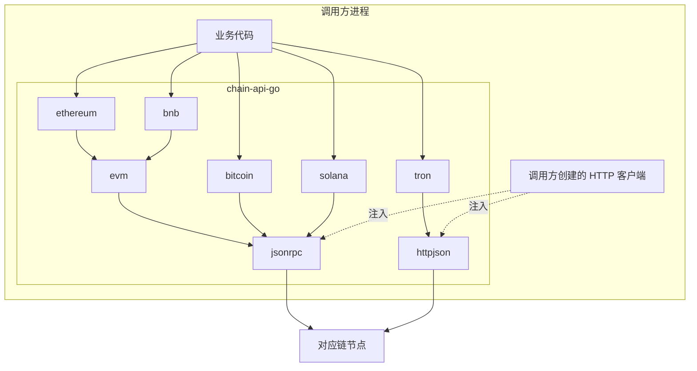

# chain-api-go

供业务服务和基建服务直接导入的 Go 多链节点 SDK。Module 为 `github.com/Stone-afk/chain-api-go`，最低 Go 版本 1.26.0。

调用方在自己的进程里创建具体链的客户端，向已配置的节点发请求，并拿到该链的原生结果。它不是独立服务，也没有统一的链入口。

## 能做什么

覆盖 Ethereum、BNB Chain、Bitcoin、Solana、Tron。每条链单独一个客户端，直接调用：

- **链状态**：区块、余额、账户、交易和回执。
- **节点计算与预检**：例如 EVM 的 `eth_call`、gas 与费用估算，Bitcoin 的 `testmempoolaccept`，Solana 的交易模拟，Tron 的常量合约调用与能量估算。
- **提交**：把调用方已经编码好的交易原样提交一次。节点接受不代表已执行或已确认，后续查询由调用方自己发起。

SDK 不接收私钥，不构造、编码或签名交易，不重试、不轮询、不切换节点。Endpoint、请求头、响应大小上限和 HTTP 客户端由调用方传入；构造客户端时不做网络请求。

## 架构



`ethereum` 与 `bnb` 复用 `evm` 的查询和提交实现，并各自持有期望的 chain ID。`evm`、`bitcoin`、`solana` 走 JSON-RPC；`tron` 走节点的 HTTP JSON 接口。`evm` 与 `solana` 在内部持有对应的上游客户端，请求仍只经过调用方注入的协议客户端发出。协议层不选择链，也不分发请求。

## 示例

把示例里的节点地址换成自己的。需要鉴权时，在 `Headers` 里传入请求头。这些程序只查询，不签名、不广播。Ethereum 是完整程序；后面三条链只写出不同的部分，`context` 和 HTTP 客户端的写法相同。

### Ethereum

BNB Chain 的用法相同，把包换成 `bnb`，chain ID 换成 `56`。

```go
package main

import (
	"context"
	"fmt"
	"math/big"
	"net/http"
	"time"

	"github.com/Stone-afk/chain-api-go/ethereum"
	"github.com/Stone-afk/chain-api-go/jsonrpc"
	"github.com/ethereum/go-ethereum/common"
)

func main() {
	ctx, cancel := context.WithTimeout(context.Background(), 10*time.Second)
	defer cancel()

	rpc, err := jsonrpc.New(jsonrpc.Config{
		Endpoint:         "https://ethereum.example",
		MaxResponseBytes: 32 << 20,
		Version:          jsonrpc.V2,
	}, &http.Client{Timeout: 10 * time.Second})
	if err != nil {
		panic(err)
	}

	var chainID big.Int
	chainID.SetInt64(1)
	client, err := ethereum.New(ethereum.Config{
		RawURL:          "https://ethereum.example",
		ExpectedChainID: chainID,
	}, rpc)
	if err != nil {
		panic(err)
	}
	if err = client.ValidateNetwork(ctx); err != nil {
		panic(err)
	}

	balance, err := client.BalanceAt(ctx, common.HexToAddress("0x0000000000000000000000000000000000000000"), nil)
	if err != nil {
		panic(err)
	}
	fmt.Println(balance) // wei；nil 区块号表示最新块
}
```

已签名的交易用十六进制字符串提交一次：`client.SendRawTransaction(ctx, signedHex)`。

### Bitcoin

Bitcoin Core 使用 `jsonrpc.Bitcoin`（JSON-RPC 1.0）。兼容 2.0 的节点改用 `jsonrpc.V2`。

```go
rpc, err := jsonrpc.New(jsonrpc.Config{
	Endpoint:         "https://bitcoin.example",
	MaxResponseBytes: 32 << 20,
	Version:          jsonrpc.Bitcoin,
}, &http.Client{Timeout: 10 * time.Second})
if err != nil {
	panic(err)
}
client, err := bitcoin.New(rpc)
if err != nil {
	panic(err)
}
height, err := client.GetBlockCount(ctx)
```

已签名交易用 `client.SendRawTransaction(ctx, bitcoin.RawTransaction(signedHex))` 提交一次。金额单位是 satoshi。

### Solana

```go
rpc, err := jsonrpc.New(jsonrpc.Config{
	Endpoint:         "https://solana.example",
	MaxResponseBytes: 32 << 20,
	Version:          jsonrpc.V2,
}, &http.Client{Timeout: 10 * time.Second})
if err != nil {
	panic(err)
}
client, err := solana.New(rpc)
if err != nil {
	panic(err)
}
account, err := ns.PublicKeyFromBase58("11111111111111111111111111111111")
if err != nil {
	panic(err)
}
balance, err := client.GetBalanceWithOpts(ctx, account, &srpc.GetBalanceOpts{
	Commitment: srpc.CommitmentConfirmed,
})
```

`balance.Value` 的单位是 lamports。已编码交易用 `client.SendEncodedTransactionWithOpts` 提交一次；模拟用 `client.SimulateRawTransactionWithOpts`，传入已经序列化的交易字节。

导入：

```go
"github.com/Stone-afk/chain-api-go/solana"
ns "github.com/solana-foundation/solana-go/v2"
srpc "github.com/solana-foundation/solana-go/v2/rpc"
```

### Tron

```go
poster, err := httpjson.New(httpjson.Config{
	Endpoint:         "https://tron.example",
	MaxResponseBytes: 32 << 20,
}, &http.Client{Timeout: 10 * time.Second})
if err != nil {
	panic(err)
}
client, err := tron.New(poster)
if err != nil {
	panic(err)
}
block, ok, err := client.GetNowBlock(ctx)
```

`ok` 为 false 表示节点返回了空对象。金额单位是 sun。已签名交易放进 `tron.TransactionPayload` 的原始 JSON，用 `client.BroadcastTransaction` 提交一次。
