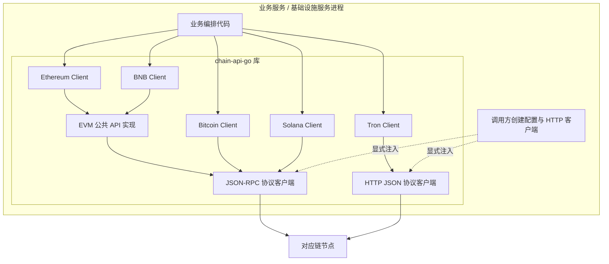
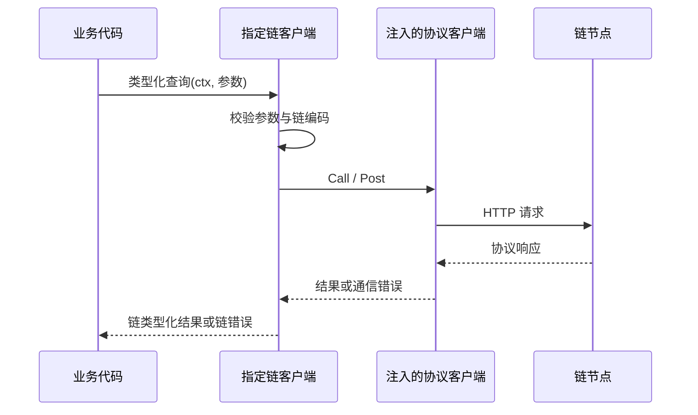
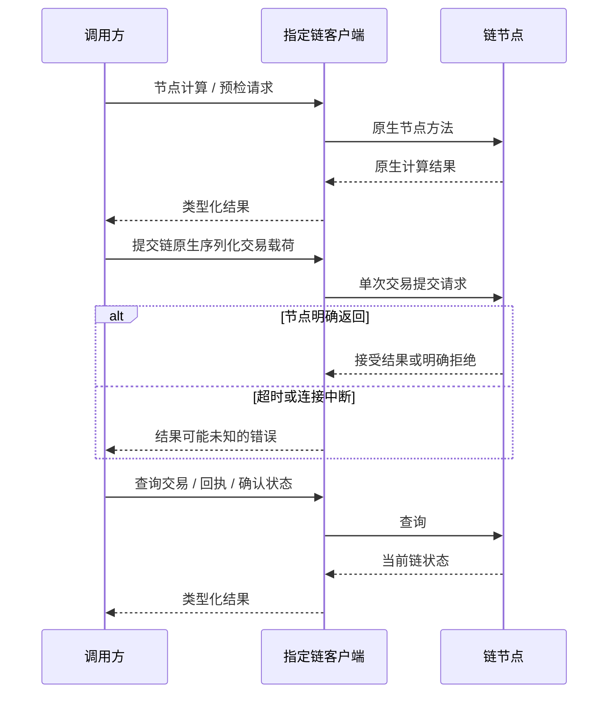
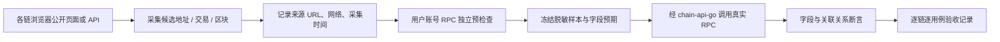

# chain-api-go 架构与技术方案

版本：v0.4 · 日期：2026-11-16 · 状态：设计草案，供评审

项目：`github.com/Stone-afk/chain-api-go`

本文定义 SDK 的目标、约束、包结构、依赖注入方式、API 设计及验证要求。代码片段是拟议 API 与设计示例，尚未实现或通过编译验证。本文不代表已有功能，也不授权启动 SDK 实现。

## 1. 项目定位

`chain-api-go` 是供业务服务、基础设施服务直接导入的 Go 多链节点 API SDK。它在调用方进程内执行，向配置的区块链节点发送请求，并返回对应链的类型化结果。

调用方直接选择 Ethereum、BNB Chain、Bitcoin、Solana、Tron 客户端。SDK 不提供统一链访问服务，不引入链适配器、链注册表、按 ChainID 分发的统一入口，也不强制各链实现同一个业务接口。

本仓库只定义链节点 API 访问能力：链状态查询、节点计算 / 预检和链原生交易提交。交易构造、编码、签名与节点访问之间必须保持技术隔离；这是核心依赖和副作用边界，不表示本仓库承担钱包业务职责。

## 2. 目标与需求追踪

| 编号 | 目标 / 硬性要求 | 设计落点 | 验收证据 |
| --- | --- | --- | --- |
| R1 | 交付可直接导入的 Go SDK / 库 | 单 Go module，按链导出客户端 | 示例直接调用 Go 方法，无 SDK 服务端 |
| R2 | 所有运行时依赖显式注入 | 构造函数接收配置和小接口 | 注入测试替身即可运行单元测试，无隐藏外部依赖 |
| R3 | 覆盖 DappLink 当前支持的所有链 | Ethereum、BNB Chain、Bitcoin、Solana、Tron | 五链分别通过能力矩阵中的基础验收 |
| R4 | 不使用链适配器和统一访问入口 | 直接创建各链客户端 | 无 IChainAdaptor、ChainDispatcher、全局链注册表 |
| R5 | 提供链原生交易提交 API | 按链保留原生载荷与节点结果 | 载荷不变、单次调用、拒绝与结果未知测试 |
| R6 | 类型明确且保留链语义 | 各链独立的请求、响应和状态类型 | 单位、编码、缺失状态和确认语义测试 |
| R7 | 可预期的请求行为 | context、错误分类、明确重试语义 | 超时、取消、节点拒绝、广播未知结果测试 |
| R8 | 使用浏览器采集的真实链上样本，通过用户测试账号 RPC 验收 | 五链样本清单、外部 live 配置、独立真实节点测试 | 采集来源、预检查、逐用例断言与脱敏结果记录 |

R1—R5、R8 来自已确认需求。R6—R7 是本方案提出的工程约束。下文的方法命名、目录与首版 API 清单是设计建议，尚不是冻结的公开 API。

## 3. 约束与范围

### 3.1 必须遵守

1. SDK 不监听端口，不提供 HTTP/gRPC 服务端，不需要独立部署。
2. 不增加统一链接口、适配器、注册中心或链路由器。公共传输接口仅描述通信，不承担链业务分发。
3. 各客户端通过构造函数接收运行时依赖；不使用全局客户端、服务定位器和 `init()` 隐式注册。
4. SDK 内不读取环境变量、配置文件或密钥文件。配置由宿主解析后传入。
5. 构造函数仅做本地验证；不联网、不自动探测节点、不启动后台任务。网络验证是显式方法调用。
6. 核心 SDK 不接收私钥，不构造、编码或签名交易，不调用节点签名或解锁接口。
7. `go-wallet-sdk` 若用于说明组合，只能位于独立示例 module；示例必须默认离线，不得默认广播或包含真实凭据。本期不强制交付该示例。
8. 交易提交 API 接收对应链的原生序列化载荷，不定义载荷的生成流程。
9. 交易有效载荷不得被修改；允许为 RPC 传输做协议要求的 hex、base64 或 JSON 封装。
10. SDK 不管理业务订单、审批、资金策略、持久化交易状态或交易生命周期编排。
11. 五条链均属于完整交付范围；开发顺序不能缩减最终链覆盖。

### 3.2 第一版建议范围

- 同步请求 API，以 HTTP 为首版传输方式；请求使用 `context.Context`。
- 每个客户端绑定一个调用方配置的 endpoint，调用方可以创建多个实例。
- 各链类型化基础 API，外加对应协议的原始请求入口。
- JSON-RPC 编解码、Tron HTTP JSON 请求、结构化错误与测试工具。
- 调用方可通过注入的传输实现加入鉴权、日志、限流与追踪。
- 默认每次调用只发起一次 SDK 级请求，不自动重试或切换节点。

多节点治理、WebSocket 订阅、自动轮询、索引器、缓存和业务集成包不作为首版必需模块。说明性的 `go-wallet-sdk` 示例也不是本期必交项；若未来加入，必须使用独立 module。若扩展引入资源或策略，仍需显式注入。

### 3.3 链支持基线

以 DappLink 提交 `2543513edd9251409048af9b6df3546b9f0152b5` 的实际注册代码作为对照基线：Ethereum、BNB Chain、Bitcoin、Solana、Tron。[来源：固定版本的 dispatcher.go](https://github.com/dapplink-external/dapplink-wallet-api/blob/2543513edd9251409048af9b6df3546b9f0152b5/chaindispatcher/dispatcher.go)

“支持同样的链”不等于复制其全部服务接口。链查询、节点计算和交易提交进入本 SDK；依赖外部索引的能力另行声明。DappLink 接口中的占位实现不作为已完成能力复制。

## 4. 总体架构



图中的公共协议客户端用于复用请求编码、发送和响应检查，不接受 ChainID，也不选择链实现。Ethereum 与 BNB 复用 EVM 代码，是库内部代码复用，不是链适配器机制。

不支持 Mermaid 的预览器可以按以下文字理解：调用方直接调用五种链客户端；Ethereum / BNB 共享 EVM 方法；EVM / Bitcoin / Solana 使用 JSON-RPC 请求；Tron 使用节点 HTTP JSON API；所有网络请求经调用方注入的 HTTP 客户端发送。

### 4.1 职责划分

| 组件 | 职责 | 不承担的职责 |
| --- | --- | --- |
| 调用方 | 选择具体链客户端、注入配置与通信资源、解释节点结果 | 不手写普通 RPC 协议报文 |
| 链客户端 | 方法封装、链参数验证、响应解析、链错误识别 | 不做跨链分发和业务编排 |
| 协议客户端 | JSON-RPC / HTTP JSON 信封、请求 ID、HTTP 状态与响应完整性检查 | 不决定业务策略或重建交易 |
| 注入的 HTTP 客户端 | 连接池、代理、TLS、鉴权及可选传输观测 | 不隐式重试交易广播 |

## 5. 依赖注入设计

### 5.1 注入边界

依赖注入覆盖运行时协作对象、外部资源和可变策略。普通结构体、标准库纯计算和内部编解码函数不需要为了注入而增加接口；`go.mod` 中的编译依赖通过版本管理控制。

| 对象 | 创建者 | 接收者 | 生命周期 |
| --- | --- | --- | --- |
| endpoint、header、网络配置 | 宿主 | 协议 / 链客户端 | 构造时复制配置，避免外部修改影响并发调用 |
| HTTPDoer | 宿主 | 协议客户端 | 宿主拥有连接池，SDK 不关闭共享 transport |
| JSON-RPC Caller | 宿主显式调用库构造函数，或使用自定义实现 | EVM / Bitcoin / Solana | 无后台任务，无独立 Close 要求 |
| HTTP JSON Poster | 宿主显式创建，或自定义实现 | Tron | 同上 |
| 鉴权 / 日志 / 限流 / 追踪 | 宿主选择的 HTTP 包装层 | 注入的通信链路 | 未启用时无需对应对象 |
| 时钟 / 等待器 / 随机源 | 将来引入重试等时间行为时由宿主提供 | 可选策略组件 | 核心单次请求 API 不强制依赖 |

构造函数不回退到 `http.DefaultClient`。必需依赖为 nil 时返回配置错误。实现需要避免 Go 接口装入 typed-nil 指针后绕过 nil 检查的问题。

### 5.2 通信接口

```go
// package transport
type HTTPDoer interface {
    Do(req *http.Request) (*http.Response, error)
}

// package jsonrpc
type Caller interface {
    Call(ctx context.Context, method string, params any, result any) error
}

type Config struct {
    Endpoint         string
    Headers          http.Header
    MaxResponseBytes int64
    Version          Version // 显式选择协议方言，不假定所有节点一致
}

func New(cfg Config, httpClient transport.HTTPDoer) (*Client, error)

// package httpjson，用于 Tron 等节点 HTTP JSON API。
type Poster interface {
    Post(ctx context.Context, path string, request any, result any) error
}

func New(cfg Config, httpClient transport.HTTPDoer) (*Client, error)
```

`any` 仅位于协议边界及原始请求入口；已封装的链方法使用明确类型。`result` 必须是可写的非 nil 指针。

协议客户端检查响应大小、HTTP 状态、JSON 格式、请求 / 响应 ID 和协议错误。JSON-RPC 信封检查遵循所选方言，不能将不同版本的 result/error 字段规则混用。非成功 HTTP 响应也应在限制大小后尝试保留节点结构化错误。

请求 ID 使用客户端内部并发安全计数器；不需要额外的全局状态或随机依赖。HTTP body 由协议客户端读取和关闭，但底层共享连接池归宿主管理。协议客户端只请求配置 endpoint；HTTP JSON 的 path 不得变成任意绝对 URL。重定向与重试行为由宿主 HTTP 客户端明确配置。

### 5.3 链客户端构造

```go
// 每行属于对应的链包；不是同一个 Go 文件。
ethereum.New(cfg ethereum.Config, rpc jsonrpc.Caller) (*ethereum.Client, error)
bnb.New(cfg bnb.Config, rpc jsonrpc.Caller) (*bnb.Client, error)
bitcoin.New(cfg bitcoin.Config, rpc jsonrpc.Caller) (*bitcoin.Client, error)
solana.New(cfg solana.Config, rpc jsonrpc.Caller) (*solana.Client, error)
tron.New(cfg tron.Config, api httpjson.Poster) (*tron.Client, error)
```

客户端返回具体类型。业务服务若需要 Mock，在自己的使用位置声明小接口，例如只含 `GetBalance` 的接口；SDK 不为了 Mock 定义包含全部链方法的巨大接口。

## 6. 包结构与依赖方向

```text
chain-api-go/
├── go.mod
├── doc.go                     # 可选：根包仅文档，不提供统一 Client
├── ethereum/                  # Ethereum 客户端与网络配置
├── bnb/                       # BNB 客户端及链特定扩展
├── evm/                       # 两者共享的 EVM API、请求与响应类型
├── bitcoin/                   # Bitcoin Core API 与独立数据类型
├── solana/                    # Solana API 与独立数据类型
├── tron/                      # Tron FullNode / 确认态查询的显式 API
├── transport/                 # HTTPDoer 边界
├── jsonrpc/                   # 通用 JSON-RPC 协议实现
├── httpjson/                  # 节点 HTTP JSON 请求实现
├── apierror/                  # 通信错误类别与原始错误信息
├── internal/
│   └── testutil/              # 协议 fixture 与测试工具
└── docs/
    └── architecture.md
```

依赖方向为：`ethereum / bnb → evm → jsonrpc → transport`；`bitcoin / solana → jsonrpc`；`tron → httpjson → transport`。错误包不反向依赖链包。

首版核心使用单 module，减少模块间版本协调成本。本仓库不引入业务集成 module；未来获批的说明性 `go-wallet-sdk` 示例必须以独立 module 隔离，不能进入核心依赖图。

不预设 DI 容器、Redis、数据库、消息队列、Web 服务框架或完整链节点 SDK 为必需依赖。引入第三方库时说明具体用途与公共 API 暴露程度。

## 7. 链能力与 API 设计

### 7.1 第一版基础覆盖矩阵

以下是拟实现和验收的基础能力，不是现有实现清单。附加方法可以逐步增加；没有类型化封装的方法可通过原始入口调用，但不能据此宣称已经完成对应的类型化能力验收。

| 链 | 节点 / 区块 | 账户 / 构造前查询 | 模拟 / 估算 | 广播 | 结果查询 |
| --- | --- | --- | --- | --- | --- |
| Ethereum | ChainID、BlockNumber、GetBlock | GetBalance、GetTransactionCount、GetCode | Call、EstimateGas、GasPrice、FeeHistory | SendRawTransaction | GetTransaction、GetTransactionReceipt、GetLogs |
| BNB Chain | 复用 EVM 同组方法 | 复用 EVM 同组方法 | 暴露节点实际支持的方法，不自动选择费用模型 | SendRawTransaction | EVM 交易 / 回执 / 日志 |
| Bitcoin | GetBlockchainInfo、GetBlockCount、GetBlockHash、GetBlock | GetTxOut、GetRawTransaction | EstimateSmartFee、TestMempoolAccept | SendRawTransaction | GetRawTransaction、GetMempoolEntry、区块关联信息 |
| Solana | GetGenesisHash、GetSlot、GetBlock | GetBalance、GetAccountInfo、GetLatestBlockhash | GetFeeForMessage、SimulateTransaction | SendTransaction | GetSignatureStatuses、GetTransaction |
| Tron | GetNodeInfo、GetNowBlock、GetBlockByNum | GetAccount、GetAccountResource、GetChainParameters | TriggerConstantContract、EstimateEnergy | BroadcastTransaction | GetTransactionByID、GetTransactionInfoByID、明确的 solidified 查询 |

方法可用性受节点版本、配置和供应商限制影响。SDK 保留明确的“不支持 / 节点拒绝”结果，不将其伪装成空数据。首版不承诺复制 DappLink 的 AA、代付、JustLend 等全部扩展业务能力；新增这些能力需要单独定义 API 范围。

### 7.2 EVM 请求与返回类型

```go
// package evm；标量类型使用检查过长度 / 编码的解析函数创建。
type Address [20]byte
type Hash [32]byte
type Data []byte

type BlockRef struct { /* 私有字段，避免同时设置 number/tag/hash */ }

func Latest() BlockRef
func Pending() BlockRef
func AtNumber(number uint64) BlockRef

type CallRequest struct {
    From                 *Address
    To                   *Address
    Gas                  *uint64
    Value                *big.Int
    GasPrice             *big.Int
    MaxFeePerGas         *big.Int
    MaxPriorityFeePerGas  *big.Int
    Data                 Data
}

func (c *Client) ChainID(ctx context.Context) (*big.Int, error)
func (c *Client) GetBalance(ctx context.Context, address Address, at BlockRef) (*big.Int, error)
func (c *Client) GetTransactionCount(ctx context.Context, address Address, at BlockRef) (uint64, error)
func (c *Client) EstimateGas(ctx context.Context, req CallRequest) (uint64, error)
func (c *Client) Call(ctx context.Context, req CallRequest, at BlockRef) (Data, error)
func (c *Client) SendRawTransaction(ctx context.Context, payload Data) (Hash, error)
func (c *Client) GetTransactionReceipt(ctx context.Context, hash Hash) (*Receipt, error)
```

缺省字段使用指针等方式保留“未提供”与“提供零值”的差异。传统 gasPrice 和动态费用参数的互斥规则在本地校验；查询类型、Quantity 与 Data 编码遵循 EVM JSON-RPC 定义。[Ethereum JSON-RPC 文档](https://ethereum.org/developers/docs/apis/json-rpc/)

Ethereum / BNB 可以通过内嵌 `*evm.Client` 提供同组方法。各自的 `Config` 保留预期网络身份配置，构造函数不发起校验请求；调用方在初始化阶段显式调用 `ValidateNetwork(ctx)`。验证失败立即返回，不进行广播。一次初始化验证不保证供应商之后不会错误切换网络，SDK 不隐藏这种限制。

### 7.3 非 EVM 接口示意

```go
// package bitcoin
func (c *Client) GetTxOut(ctx context.Context, req GetTxOutRequest) (*TxOut, error)
func (c *Client) EstimateSmartFee(ctx context.Context, req EstimateSmartFeeRequest) (*FeeEstimate, error)
func (c *Client) SendRawTransaction(ctx context.Context, payload RawTransaction) (TxID, error)

// package solana
func (c *Client) GetLatestBlockhash(ctx context.Context, opts BlockhashOptions) (*BlockhashResult, error)
func (c *Client) SimulateTransaction(ctx context.Context, tx EncodedTransaction, opts SimulateOptions) (*SimulationResult, error)
func (c *Client) SendTransaction(ctx context.Context, payload EncodedTransaction, opts SendOptions) (Signature, error)

// package tron
func (c *Client) GetAccount(ctx context.Context, req GetAccountRequest) (*Account, error)
func (c *Client) BroadcastTransaction(ctx context.Context, payload TransactionPayload) (*BroadcastResult, error)
func (c *Client) GetTransactionInfoByID(ctx context.Context, id TxID) (*TransactionInfo, error)
```

这些 DTO 在各自链包定义：Bitcoin 的原始交易编码、Solana 的编码类型 / commitment / preflight 选项、Tron 的地址格式 / visible / 原生交易结构各自保留。提交类型必须无损承载对应链的序列化交易载荷。

Tron 使用 HTTP POST 节点 API，首版不强行包装成 JSON-RPC。`GetAccount` 对“无此账户”和“已有零余额账户”做区分，并处理 HTTP 200 内的链错误。[Tron GetAccount 文档](https://developers.tron.network/reference/account-getaccount)

### 7.4 数据约定

- 金额与费用不使用 `float64`。EVM 使用最小单位整数；Bitcoin 十进制数精确解析；其他链按协议保留整数和明确单位。
- 不定义跨链通用 `Transaction`，避免丢失 UTXO、slot、资源消耗等语义。
- 不跨链统一为一个 `success bool`。保留接受、执行结果、确认、finalized / solidified 等原生信息。
- 合法的 RPC `null` 按方法返回 `(nil, nil)`，表示当前查无结果；节点报错返回 error。每个方法的 GoDoc 必须解释这一约定。
- 返回 `null` 不证明交易失败或从未提交；可能是 pending、节点落后或历史不可用。
- SDK 不修改调用方传入的切片、map 和大整数；不保留请求参数用于后台任务。调用方在同步调用完成前不得并发修改这些参数。
- 未知响应字段允许忽略，关键必需字段和格式必须验证；原始入口可使用 `json.RawMessage` 保留完整结果。

### 7.5 原始调用入口

JSON-RPC 客户端提供 `RawCall(ctx, method, params, result)`；Tron 提供 `RawPost(ctx, path, request, result)`。入口继承相同的超时、响应大小限制和错误处理。

原始入口不进行跨链转换，也不推断方法是否可安全重试。使用原始入口时，调用方负责方法语义；SDK 的类型化能力声明不包含未封装方法。

### 7.6 节点 API 与索引数据的边界

Bitcoin `getrawtransaction` 的历史查询取决于交易是否在 mempool、是否提供可用区块信息或节点是否启用 txindex；不能承诺任意节点都能查询任意历史交易。[Bitcoin getrawtransaction 文档](https://developer.bitcoin.org/reference/rpc/getrawtransaction.html)

Bitcoin Core 的 `listunspent` 与全链地址索引是不同能力。首版不把它包装成通用的“任意地址 UTXO 查询”。[Bitcoin listunspent 文档](https://developer.bitcoin.org/reference/rpc/listunspent.html)

全地址交易历史、资产聚合等需要索引数据的能力由宿主或独立扩展库提供。缺少数据源时不能通过返回空列表表示“该地址没有交易”。

## 8. 调用流程

### 8.1 普通查询



JSON-RPC 方法名、请求 ID 和信封由本库处理。

### 8.2 节点计算与交易提交



本仓库只定义节点计算、交易提交和结果查询的 API 契约，不描述交易载荷的生成过程。

### 8.3 五链提交与结果差异

| 链 | 提交 API | 节点接受后的核实 |
| --- | --- | --- |
| Ethereum / BNB | SendRawTransaction | receipt、执行状态和确认信息 |
| Bitcoin | SendRawTransaction | mempool、区块收录与确认数 |
| Solana | SendTransaction | signature status 与 commitment |
| Tron | BroadcastTransaction | 执行信息与 solidified 状态 |

Solana 广播成功只表示 RPC 接受请求，不保证交易已经执行或确认；客户端保留 preflight 和节点重发选项，不把这些选项等同于 SDK 自身重试。[Solana sendTransaction 文档](https://solana.com/docs/rpc/http/sendtransaction)

Tron 广播返回成功也不是最终执行回执；确认和执行信息需要后续查询。提交失败或结果未知时 SDK 不修改交易载荷。[Tron BroadcastTransaction 文档](https://developers.tron.network/reference/broadcasttransaction)

## 9. 调用示例

### 9.1 创建与查询

```go
// 示例位于宿主项目。所示链 API 是本方案设计签名。
// cfg 已由宿主读取；ctx 由宿主设置截止时间。
httpClient := &http.Client{Timeout: cfg.RequestTimeout}

rpcClient, err := jsonrpc.New(jsonrpc.Config{
    Endpoint:         cfg.EthereumEndpoint,
    Headers:          cfg.Headers,
    MaxResponseBytes: cfg.MaxResponseBytes,
    Version:          jsonrpc.V2,
}, httpClient)
if err != nil {
    return err
}

client, err := ethereum.New(ethereum.Config{
    ExpectedChainID: cfg.ExpectedChainID,
}, rpcClient)
if err != nil {
    return err
}
if err := client.ValidateNetwork(ctx); err != nil {
    return err
}

address, err := evm.ParseAddress(cfg.Address)
if err != nil {
    return err
}
balance, err := client.GetBalance(ctx, address, evm.Latest())
if err != nil {
    return err
}
// balance 为 wei，展示单位转换由业务方决定。
_ = balance
```

HTTP 客户端由宿主创建，其连接池可以按宿主策略共享。本 SDK 不替宿主创建另一个客户端，不要求构造 SDK 后再将其注册到统一对象。

## 10. 错误与请求语义

### 10.1 结构化错误

```go
// package apierror
type Error struct {
    Kind              Kind
    Method            string
    HTTPStatus        int
    RPCCode           *int
    NodeCode          string // 保留 Tron 等链的字符串错误码
    Message           string
    Data              json.RawMessage
    SubmissionUnknown bool
    Cause             error
}

func (e *Error) Error() string
func (e *Error) Unwrap() error
```

建议 Kind 包括 `InvalidArgument`、`Configuration`、`Transport`、`HTTP`、`Protocol`、`RPC`、`Unsupported`、`NetworkMismatch`。用 `errors.Is` 保留 context 取消 / 超时判断，用 `errors.As` 获取节点细节。

只有可以确认的错误才映射为“不支持”；未知错误保留原始信息，不仅凭英文 message 猜测分类。错误结构与默认字符串不得包含带凭据的完整 URL、鉴权 header 或整笔原始交易。

`SubmissionUnknown` 表示广播可能已到达节点但调用方无法确认结果。发送后超时、连接中断以及部分网关错误应保守处理；它不表示交易已接受，也不表示交易已失败。本地参数错误属于明确未发送。若注入的传输不能证明是否发出请求，不得声称“肯定没发出”。

### 10.2 重试、超时与一致性

- 首版 SDK 默认不重试；注入传输也必须明确披露重试行为，不能隐式重放 POST 广播。
- 只读请求的显式重试可由宿主包装 `jsonrpc.Caller` 完成，但 `latest` / `pending` 重读可能得到不同状态。
- 交易提交重发必须保留相同序列化载荷；SDK 默认不重发或重建。
- `context` 取消应中断 HTTP 请求；返回时保留原始原因。调用方设置总超时，传输层 timeout 作为上限补充。
- 首版不提供隐式 polling、订阅、批量并发和节点切换。普通方法调用的资源生命周期应在调用返回时结束。
- 如后续加入 JSON-RPC batch，应按 ID 关联响应并逐项返回错误，不依赖响应顺序，也不承诺多项查询是同一快照。

## 11. 并发、资源与可观测性

客户端在配置不可变、注入依赖支持并发时可被多个 goroutine 共享。网络请求使用局部响应对象，请求 ID 安全递增；不得把最近 nonce、账户状态或响应缓存在全局变量中。

HTTP 连接池由宿主管理。首版不提供可能关闭共享连接的 `Client.Close()`。将来如果引入每个订阅独占的资源，资源拥有者和取消方式必须在该 API 中明确表达。

日志和追踪可由宿主的 HTTPDoer / Caller 包装层注入。建议记录链包名、方法、耗时、结果类别；不默认记录地址、完整交易载荷、完整 RPC 参数或凭据。地址和交易 hash 不宜直接作为高基数指标标签。

## 12. 测试与验收设计

### 12.1 测试层次

测试分为离线确定性测试和真实节点验收。离线测试覆盖协议、异常和并发；真实验收必须从各链浏览器采集公开地址、交易标识、区块等数据，使用用户测试账号的 RPC 验证实际返回结果，不能只依赖 Mock 或判断请求是否成功。

| 测试范围 | 关键风险 | 验证方式 |
| --- | --- | --- |
| 构造与 DI | 隐藏联网、全局依赖、缺依赖被静默补齐 | 注入 fake；构造阶段零调用；nil / typed-nil 输入 |
| 协议层 | 错误 ID、截断 JSON、超大响应、HTTP 错误丢失 | `httptest.Server` 和固定响应 fixture |
| EVM / BNB | Quantity/Data 混淆、费用字段冲突、null 回执 | 请求快照与类型化解析测试，两链分别运行 |
| Bitcoin | 精度丢失、txindex 不可用误报不存在 | 精确金额 fixture 与节点错误映射 |
| Solana | commitment 丢失、blockhash / 有效高度丢失 | 请求参数与状态 fixture |
| Tron | HTTP 200 链错误、地址格式、零余额与不存在混淆 | HTTP JSON 与广播失败 fixture |
| 交易提交 | 超时误判失败、自动重建、载荷变化 | 请求次数断言、载荷对比、提交未知错误测试 |
| 并发与资源 | 竞争、重复 ID、未关闭响应 body | `go test -race`、并发 fixture、body 关闭断言 |
| 五链真实数据 | 链身份错误、字段映射错误、浏览器与 RPC 不一致 | 浏览器采样、独立预检查、冻结样本清单、SDK 实际调用 |

基础测试无需公网、凭据或真实资金。真实节点测试是完整验收的必需部分，但从普通单元测试入口隔离。受环境影响的失败、跳过或未运行，均不能计为验收通过。

### 12.2 参考项目与配置方式

参考仓库为 `/Users/stone/the_web3/evm-scanner-service`。本次只读核对的实现包括：

- `internal/test/integration/live_helpers_test.go`：通过 `CHAIN_INDEXER_LIVE_E2E` 开启 live 测试，通过 `CHAIN_INDEXER_LIVE_CONFIG` 选择配置；载入固定样本、检查样本摘要、设置运行时间和请求预算。
- `internal/test/integration/live_manifest_test.go`：记录样本来源、区块身份、交易和日志预期字段，校验样本内容摘要。
- `internal/test/integration/live_harness_test.go`：检查测试结果记录、遗漏 / 跳过和失败诊断脱敏行为。

本 SDK 沿用“外部配置 + 测试装配 + 固定真实样本 + 可核查结果”的方式，不复制扫描服务的数据库、七条 EVM 链约束、WebSocket 或服务生命周期。

拟为本项目提供独立的测试配置入口 `CHAIN_API_GO_LIVE_CONFIG` 和开关 `CHAIN_API_GO_LIVE_TEST`。这些名称是待实现设计，不代表现有命令已可运行。

1. 测试运行器读取用户提供的本地配置或环境变量，创建 HTTP / RPC 客户端，再注入对应链客户端。SDK 核心仍不读环境变量或文件。
2. 优先复用用户在参考项目中使用的测试账号 RPC 资源；只复用已明确配置且网络匹配的 endpoint，不推测 API key 对其他链的权限，也不改写 URL 猜测新 endpoint。
3. Ethereum / BNB 的已有配置可作为来源；Bitcoin、Solana、Tron 是否已具备账号 endpoint，需在真实验收前预检查。本次未读取凭据或验证五链 endpoint 可用性。
4. “测试账号”指 RPC 供应商账号，不代表区块链测试网。主网浏览器样本必须使用对应主网 RPC；测试网样本必须使用同一测试网 RPC。
5. 本地凭据配置不提交到仓库；仓库只保存环境变量占位的模板。日志和样本不保存带 key 的 URL、Authorization、供应商响应中的凭据。
6. 配置中需要独立设置请求总数、每链并发、速率和总时限。耗尽预算即报告未完成，不切换到未声明的公共 RPC 来伪装账号验证成功。

### 12.3 浏览器采样流程

采样工作由开发 / 验收工具执行，不进入 SDK 的运行时依赖，不在每次回归测试中重新随机爬取样本。



具体流程：

1. 选择对应网络的浏览器，采集公开交易详情和关联地址、区块、合约或账户信息。优先使用浏览器公开 API；页面可用时做有界解析，不绕过验证码或访问控制。
2. 记录每个字段的来源，区分浏览器直接展示值与独立 RPC 补充值。浏览器标签、法币估值、四舍五入金额不作为协议精确断言。
3. 使用直接 RPC 请求等独立路径进行预检查，不通过被测 SDK 生成自己的全部预期结果，避免同一解析错误同时进入预期值和实际值。
4. 关联交易与所在区块，核对网络身份及样本的稳定确认状态。优先选择已充分确认且仍可被账号节点读取的历史交易。
5. 样本审核后冻结清单和内容摘要；后续测试只消费固定清单。变更样本必须记录旧标识、新标识、替换原因和重新预检查结果，不能在测试失败后静默换样本。
6. 浏览器不可用、需要额外 API key、历史节点权限不足等作为明确的采样 / 环境阻塞记录。未完成采样的链不得记为通过。

### 12.4 各链样本覆盖

每条链至少采集 3 个不同的已确认交易样本及其关联地址 / 账户与区块；该数量只是最低起点，仍需满足以下语义覆盖。一个样本可以覆盖多个断言。

| 链 | 浏览器来源候选（采样时确认网络与可访问性） | 样本类别与核心断言 |
| --- | --- | --- |
| Ethereum | Etherscan 对应网络浏览器 | 原生转账、ERC-20 Transfer、已收录但执行失败交易；交易 hash、区块 hash、高度、from/to、value、receipt status、日志 topics/data |
| BNB Chain | BscScan 对应网络浏览器 | 原生转账、代币 Transfer、合约调用；独立核验网络身份、交易字段、回执和日志，不能用 Ethereum 通过代替 |
| Bitcoin | mempool.space / Blockstream 对应网络浏览器 | 多输出、SegWit、不同输入 / 输出结构；txid、wtxid（适用时）、区块关联、vin/vout、脚本和精确金额，不把地址当作每种脚本的必有字段 |
| Solana | Solana Explorer / Solscan 对应网络浏览器 | SOL 转账、代币转账、失败交易；signature、slot、账户列表、meta.err、费用、前后余额；读取保留节点提供的版本 / commitment 信息 |
| Tron | TRONSCAN 对应网络浏览器 | TRX 转账、TRC-20 调用、执行失败交易；txID、区块关联、地址编码、执行回执、资源 / 费用和事件日志 |

浏览器样本用于检验本 SDK 返回的原始交易 / 日志 / meta 等数据，不因此扩展为资产索引或代币业务解析服务。Bitcoin 没有与 EVM 回执相同的“已上链但执行失败”类别，不为满足统一表格而伪造此样本。

### 12.5 样本清单与断言规则

拟将不含凭据的样本清单保存到 `internal/test/live/testdata/<chain>/samples.json`，每个样本至少包含：

| 字段 | 含义 |
| --- | --- |
| sample_id、case_ids | 稳定样本编号及覆盖的验收用例 |
| chain、network、network_identity | 链和网络身份；EVM chain ID 或该链适用的身份信息 |
| source_url、observed_at | 浏览器来源链接及带时区的采集时间 |
| transaction_id、addresses | 真实交易标识及关联公开地址 / 账户 |
| block_hash、block_height / slot | 适用于该链的历史定位信息，不强制不同链使用同一个高度模型 |
| expected、field_sources | 冻结的精确预期字段及各字段证据来源 |
| rpc_preflight | 预检查时间、方法、脱敏 endpoint 别名、节点可用性与结果 |
| requirements | 节点历史查询、archive、txindex 或 API 权限要求 |
| manifest_version、content_digest | 样本版本及规范化内容摘要，时间元数据与内容摘要规则分开定义 |

断言分为两类：

- **固定历史断言**：交易和区块身份、执行结果、日志及精确金额。比较前只进行明确的协议等价归一化，不掩盖缺失字段与零值的区别。
- **动态状态断言**：当前余额、nonce、最新高度、费用估算和确认数。不得与采集当天的值永久做等值比较。支持历史查询的节点可固定 block reference；否则验证类型、单位和业务不变量，并记录观测时间 / context slot。先后两次 latest 查询不天然构成相同快照。

历史已花费输出不能被永久用作 `GetTxOut` 返回非空的预期；查询不到交易也不直接断言交易从未存在。需要依赖实时状态的方法使用独立动态用例，说明节点与时间前提。

### 12.6 只读验收与广播验收分离

浏览器采集的主网地址、hash 等数据只用于真实查询和结果核对，不能据此获得交易提交授权。

- 只读 live 套件使用用户测试账号 RPC，覆盖身份、历史交易、区块、账户和结果查询；已有的公开真实数据作为验收输入。
- 模拟 / 估算测试需使用参数完整、适合当前状态的输入。历史失败或过期交易可验证特定失败语义，但不能假定它们在当前状态下仍可成功模拟。
- 提交编码、未知结果、节点拒绝等首先通过离线测试验证。真实提交使用单独启用的测试网 / 受控节点套件及调用方提供的专用交易载荷。
- 不自动重播浏览器抓取的主网交易，不以真实主网转账完成普通回归测试。
- 真实查询通过不等于真实广播通过；报告分开标明。尚无专用广播测试材料时，广播 live 项保持未验证，不影响已完成查询项的事实记录，但不得宣称完整验收通过。

### 12.7 运行记录与验收条件

每次 live 运行记录：代码版本、样本摘要、链和网络、脱敏 endpoint 别名、开始时间、请求数量、用例 ID、PASS / FAIL / BLOCKED / NOT_RUN、错误类别及断言差异。普通测试中未启用 live 可以跳过；正式五链验收中，要求执行的项目被跳过或漏跑应阻止整体通过。

供应商限流、凭据无权限、历史数据不可用与 SDK 字段错误分别分类，不将外部故障直接认定为代码缺陷，也不把它们计为成功。报告不输出凭据、完整带鉴权 endpoint 或未脱敏的网络错误串。

验收条件：

1. R1—R8 均有对应证据；五链基础矩阵全部完成，不用原始入口替代类型化覆盖声明。
2. 核心包不存在私钥、交易构造、编码、签名、节点解锁、服务监听、统一链注册与分发能力。
3. 构造函数无网络和后台副作用，必需依赖全部可替换。
4. 查询成功、节点拒绝和广播结果未知能够区分。
5. 所有金额单位、编码、可空结果和节点前置条件有 GoDoc。
6. 五链均具备真实浏览器来源、固定样本、独立预检查和用户测试账号 RPC 的真实调用证据，不以 Mock 替代真实验收。
7. 历史与动态断言分开，样本更新可追踪，主网查询与受控提交验证结果分开记录。

当前状态：以上为更新后的验收设计。已只读检查参考仓库的测试装配与清单机制；本轮未采集五链样本、读取账号凭据、调用真实 RPC 或发送交易。

## 13. 实施顺序与评审事项

建议按以下顺序实施，阶段顺序不缩减五链交付范围：

1. 冻结公开 API 命名、DI 边界、错误与响应空值约定。
2. 实现协议层和离线测试工具。
3. 实现 EVM 公共 API，以及 Ethereum / BNB 独立客户端。
4. 实现 Bitcoin、Solana、Tron 类型化 API 和各链 fixture。
5. 从五链浏览器采样、以用户账号 RPC 独立预检查并冻结清单，完成真实查询、受控提交及文档验收。

进入开发前，需要把基础矩阵细化为逐方法参数 / 响应定义，并锁定 Go 版本、节点兼容范围和示例依赖版本。本设计不声称已经完成这些兼容性验证。

本轮建议重点评审：首版是否接受 HTTP + 单 endpoint + 不自动重试的范围；基础 API 清单是否覆盖实际业务；是否有必须首版加入的 DappLink 特殊扩展。此前已经确定的“库形态、全依赖注入、五链覆盖、无链适配器和统一入口”不重新作为待选事项。

## 14. 设计决策摘要

| 决策 | 原因 |
| --- | --- |
| 直接暴露链客户端 | 满足按链使用 API SDK 的要求，避免引入服务式分发 |
| 公共代码复用限制在协议和 EVM 能力 | 复用相同实现，同时保留非 EVM 语义 |
| 构造函数注入，不绑定 DI 框架 | 宿主控制资源与策略，测试可替换依赖 |
| 不包含业务集成层 | 仓库只维护链节点 API 与测试验收能力 |
| 构造签名能力与节点访问隔离 | 核心不接收私钥或提供签名；说明性 go-wallet-sdk 示例只能位于独立 module |
| 默认单次请求 | 保持 API 封装行为可预期，避免隐藏广播副作用 |
| 以固定 DappLink 提交确定链范围 | 需求可复现，后续扩链有明确变更依据 |

本文中的架构、接口与实施顺序均为 `chain-api-go` 的拟议设计；外部项目事实与节点协议语义在相应段落附有来源。
