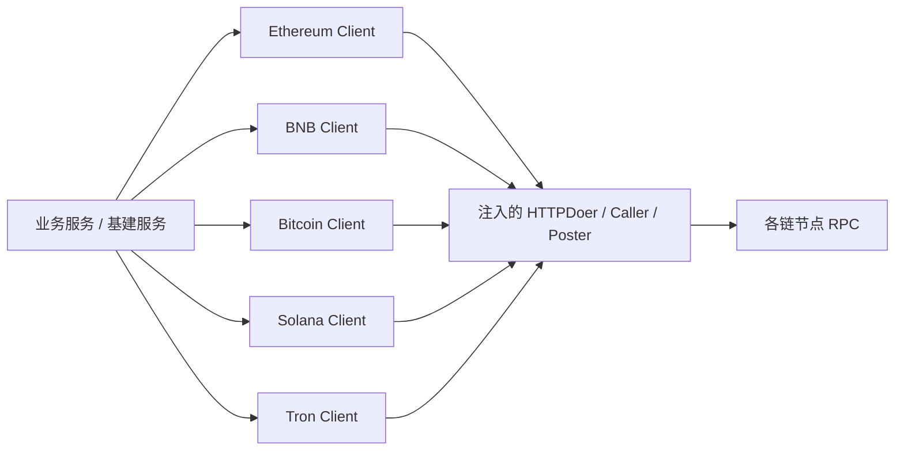
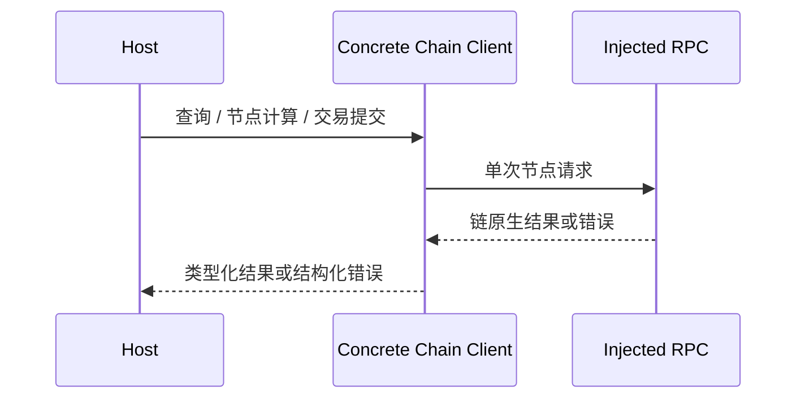

# chain-api-go 技术方案

**规格文档 / Spec**：[spec.md](spec.md)  
**技术方案 / Plan**：[plan.md](plan.md)  
**任务清单 / Tasks**：[tasks.md](tasks.md)  
**基线版本 / Baseline Version**：PLAN-v6+CONTEXT-CAUSE-v1+HARNESS-CONTRACT-v1+EVM-CONTRACT-v1+BITCOIN-CONTRACT-v1+EVM-RAW-DTO-v1+RAW-ERROR-v1
**日期 / Date**：2026-11-17
**状态 / Status**：T017/T018 已通过 RED、Auditor 与 Human 门禁并获准集成；T019 及以后任务未授权（T017/T018 Complete）

## 0. 变更记录 / Change Log

| 版本 / Version | 日期 / Date | 变更 / Change |
|---|---|---|
| RAW-ERROR-v1 | 2026-11-17 | Human 已批准：恢复原始节点 Message/Data、HTTP 错误正文及底层 Cause；区分 SDK 返回与 live 脱敏输出。重开 T017–T022，修订 T025/T026；T025 当前 RED/审核不能作为新基线门禁。T023/T024 未受影响证据保留，SDK→harness 输出隔离在 T033/T034 验证。保持 5 Plan / 20 Task、T017–T036 ID 与原路径；T027 继续暂停。constitution 1.3 同时获批；T017/T018 已完成门禁并获准集成，T019 未授权。 |
| EVM-RAW-DTO-v1 | 2026-11-17 | Human 已批准：将 EVM 收敛为原始 RPC DTO + 必要转换，接受破坏性 API 变更且不提供兼容层；重开 T025/T026，旧证据 stale。T025 可进入 RED，T026 仍等待审核和 Human 门禁；Bitcoin 候选暂停。保持 5 Plan / 20 Task、路径和依赖，不改 constitution。 |
| BITCOIN-CONTRACT-v1 | 2026-11-17 | 候选：补齐 PLAN-003 十方法、DTO、金额/费率、历史和 wire 契约；T027 暂停待批准。只改三件套；保持 5 Plan / 20 Task、全部依赖、T027 七路径、T028 五路径和 T017–T026 有效证据。 |
| EVM-CONTRACT-v1 | 2026-11-16 | Human 已批准：新增最小 `evm.New` seam，冻结首版 EVM DTO 与 EC-01–05 的精确验收；修订 T025 的声明预算及 20/20/30 分钟时箱。仅影响 PLAN-002 契约；T025 可恢复、T026 未启动，既有 5 Plan / 20 Task 和 T017–T024 不变。 |
| HARNESS-CONTRACT-v1 | 2026-11-16 | Human 已批准：冻结 test-only live harness 的显式配置、raw-byte SHA-256、可取消并发等待、总 deadline context、结果优先级与离线并发验证；只重开 T023/T024，保持 5 Plan / 20 Task、任务 ID 与依赖不变。T017–T022 的未受影响证据保持有效。 |
| CONTEXT-CAUSE-v1 | 2026-11-16 | Human 批准安全的跨包 context cause 值方法；重新执行 T017 RED、T018 GREEN 及固定 Auditor 门禁，不增加 Task。 |
| PLAN-v6 | 2026-11-16 | 将 v5 的混合 Task 改为独立测试/实现依赖，活动任务为 T017–T036；补充默认拒绝路径、预算、证据门禁和 constitution 8.6 冲突裁决。功能范围不变；Human 已明确批准本修订。 |

## 1. 设计结论

采用“共享协议层 + 五链原生客户端 + 测试专用 live harness”的结构。共享只发生在传输、错误和 EVM 原生能力层，不引入链适配器、统一访问入口或业务流程。



## 2. 包结构

```text
transport/                 # HTTPDoer 接口
apierror/                  # 保留原始信息的结构化错误
jsonrpc/                   # JSON-RPC 2.0 / Bitcoin 方言
httpjson/                  # Tron 同 endpoint HTTP JSON
evm/                       # Ethereum/BNB 共用原生类型与方法
ethereum/                  # Ethereum 具体客户端
bnb/                       # BNB 具体客户端
bitcoin/                   # Bitcoin Core 客户端
solana/                    # Solana 客户端
tron/                      # Tron 客户端
internal/test/live/        # 测试专用真实数据装配与证据
```

依赖方向固定为：具体链包 → 协议包 → `transport`；`ethereum`/`bnb` → `evm` → `jsonrpc`；`tron` → `httpjson`。核心包不得反向依赖 live 测试。

## 3. 公共代码契约

```go
type HTTPDoer interface {
    Do(*http.Request) (*http.Response, error)
}

type Caller interface {
    Call(context.Context, string, any, any) error
}

type Poster interface {
    Post(context.Context, string, any, any) error
}

jsonrpc.New(jsonrpc.Config, transport.HTTPDoer) (*jsonrpc.Client, error)
httpjson.New(httpjson.Config, transport.HTTPDoer) (*httpjson.Client, error)

ethereum.New(ethereum.Config, jsonrpc.Caller) (*ethereum.Client, error)
bnb.New(bnb.Config, jsonrpc.Caller) (*bnb.Client, error)
evm.New(jsonrpc.Caller) (*evm.Client, error) // EVM-CONTRACT-v1 跨包构造 seam
bitcoin.New(bitcoin.Config, jsonrpc.Caller) (*bitcoin.Client, error)
solana.New(solana.Config, jsonrpc.Caller) (*solana.Client, error)
tron.New(tron.Config, httpjson.Poster) (*tron.Client, error)
```

规则：

- 构造函数复制可变配置并拒绝 nil/typed-nil；只做本地校验。
- `context.Context` 是每个 I/O 方法首参；调用方必须提供有效 context，公共协议层负责验证与取消。EVM 不重复该检查。
- 金额不使用浮点；EVM 原始 DTO 保留原生 hex string，必要标量转换使用整数或 `big.Int`。
- nullable 字段必须保留协议语义，不得把缺失解释为零。
- RawCall/RawPost 复用同一限长、context 和原始错误保留规则。
- 命名常量类型按底层类型提供 `ToString()`、`ToInt()`、`ToInt32()`、`ToInt64()` 等明确转换方法，不提供含糊的通用 `Value()`。
- 小字段、小结构体及其参数、返回值、构造器传参默认使用值语义。仅 `Client` 等包含大量方法或持有大量依赖并负责复杂生命周期的实现对象允许使用指针。
- 指针规则不授权批量重写既有指针。数据库 `NULL` 或第三方 API 契约需要指针时，记录准确冲突并等待用户决定。
- 核心 SDK 不接收私钥，不提供交易构造、编码、签名或节点解锁能力。说明性 `go-wallet-sdk` 示例若未来获批，只能位于独立 module，并保持默认离线、无默认广播和无真实凭据；本期不要求交付该示例。

### 3.1 值语义接口裁决 / Value-Semantics API Decisions

```go
// bitcoin
func (c *Client) GetTxOut(ctx context.Context, req GetTxOutRequest) (TxOut, bool, error)
func (c *Client) EstimateSmartFee(ctx context.Context, req EstimateSmartFeeRequest) (FeeEstimate, bool, error)

// solana
func (c *Client) GetLatestBlockhash(ctx context.Context, opts BlockhashOptions) (BlockhashResult, bool, error)
func (c *Client) SimulateTransaction(ctx context.Context, tx EncodedTransaction, opts SimulateOptions) (SimulationResult, bool, error)

// tron
func (c *Client) GetAccount(ctx context.Context, req GetAccountRequest) (Account, bool, error)
func (c *Client) BroadcastTransaction(ctx context.Context, payload TransactionPayload) (BroadcastResult, bool, error)
func (c *Client) GetTransactionInfoByID(ctx context.Context, id TxID) (TransactionInfo, bool, error)
```

EVM 的请求、DTO 和必要数值转换以 §3.2 为准。其他链继续使用已批准的值语义与存在性契约；本修订不迁移其他链、不引入统一 Optional。

上述 nullable 签名的第二个返回值统一表示 `present`。合法空结果为 `(零值,false,nil)`，有效结果为 `(值,true,nil)`，错误为 `(零值,false,error)`。成功时协议要求必有结果的方法必须返回 true，不能因增加 bool 而放宽必需字段或响应合法性。

Bitcoin `EstimateSmartFee` 除外：其 bool 表示 `hasEstimate`；收到无估值结果时保留节点 Blocks/Errors 并返回 false，见 §3.3 BC-03。

具体链与协议 `*Client` 保持指针构造器和方法接收者，因为这些对象包含大量方法并持有通信依赖。`HTTPDoer.Do(*http.Request) (*http.Response,error)` 仅因兼容标准库 `http.Client.Do` 契约而保留，是本次要求 Human 明确批准的唯一标准库指针签名；不授权其他 SDK DTO 使用指针。

### 3.2 EVM-RAW-DTO-v1 首版契约 / First-Release Contract

**依据与选择。** 2026-11-17 只读观察：当前 HEAD 为 `d3502b8c151de849bfc545656ce2dd81d87d1e86`，另有未提交 `evm/client.go`；`types.go`/`query.go` 合计 632 行。参考 `/Users/stone/cndt/chain-scanner-core-go/rpc/evm/{types,client,hex}.go` 合计 216 行，但只覆盖四方法，不能直接作为本 SDK 行数目标。只借鉴原始字段与按需转换，不复制配置、logger、默认客户端、重试或 dispatcher。

| 方案 | 复杂度/性能/扩展性 | 兼容性/风险/维护 | 决定 |
|---|---|---|---|
| 保留强类型领域模型 | 立即转换全部字段，解析分支多，新字段需扩展解析器；无已测性能优势 | API 变化较少，但继续维护 Has、所有权与 schema 分支 | 拒绝 |
| 原始 RPC DTO + 必要转换 | 标准解码，业务需要时转换；新增字段只增加 DTO 字段 | 有公开 API 破坏；减少解析维护，调用方负责 DTO 数值解释 | Human 已选 |
| 完整复刻 scanner 客户端 | 当前四方法实现较小，但扩至 14 方法仍需设计 | 配置/路由/指针/默认行为不符合本 SDK 边界 | 拒绝 |

[官方 JSON-RPC 文档](https://ethereum.org/developers/docs/apis/json-rpc/)支持 Quantity/Data、pending 与合约创建 null 语义；[Go encoding/json](https://pkg.go.dev/encoding/json)定义标准解码、RawMessage、未知字段和重复键行为。访问日期 2026-11-17；公开 Go 形状及校验范围是本项目候选决定。无需新增 PoC、依赖或 benchmark，T025 的离线 fixture 提供可行性证据。

#### ER-01：公开 API

`Address`、`Hash`、`Data` 保留名称，仅作为原始 wire 字符串，不再是校验后的领域对象。此最小命名保留 constitution 8.1；DTO 内字段使用基础类型。删除 `ParseAddress`/`ParseHash`/`ParseData` 及三个类型的 `MarshalJSON`；不保留兼容层。

```go
type Address string
type Hash string
type Data string
func (v Address) ToString() string
func (v Hash) ToString() string
func (v Data) ToString() string

func Latest() BlockRef
func Pending() BlockRef
func AtNumber(uint64) BlockRef
func (v BlockRef) MarshalJSON() ([]byte, error)

func New(jsonrpc.Caller) (*Client, error)
func (c *Client) ChainID(context.Context) (big.Int, error)
func (c *Client) BlockNumber(context.Context) (uint64, error)
func (c *Client) GetBlock(context.Context, BlockRef) (Block, bool, error)
func (c *Client) GetBalance(context.Context, Address, BlockRef) (big.Int, error)
func (c *Client) GetTransactionCount(context.Context, Address, BlockRef) (uint64, error)
func (c *Client) GetCode(context.Context, Address, BlockRef) (Data, error)
func (c *Client) GetTransaction(context.Context, Hash) (Transaction, bool, error)
func (c *Client) GetTransactionReceipt(context.Context, Hash) (Receipt, bool, error)
func (c *Client) GetLogs(context.Context, LogFilter) ([]Log, error)
func (c *Client) Call(context.Context, CallRequest, BlockRef) (Data, error)
func (c *Client) EstimateGas(context.Context, CallRequest) (uint64, error)
func (c *Client) GasPrice(context.Context) (big.Int, error)
func (c *Client) FeeHistory(context.Context, uint64, BlockRef, []float64) (FeeHistoryResult, error)
func (c *Client) SendRawTransaction(context.Context, Data) (Hash, error)
```

RPC 方法和位置参数保持当前映射。`ethereum`/`bnb` 各自保留 `Config{ExpectedChainID big.Int}`、`New(Config,jsonrpc.Caller)`、内嵌 `*evm.Client` 及 `ValidateNetwork`。ExpectedChainID 必须正数且构造时深拷贝；ValidateNetwork 只调用一次 ChainID，不自动执行。1/56 只是测试样例，不是网络白名单。

#### ER-02：完整 DTO 字段

| DTO | 精确 Go 字段 |
|---|---|
| CallRequest | `From, To, Gas, Value, GasPrice, MaxFeePerGas, MaxPriorityFeePerGas, Data string` |
| LogFilter | `FromBlock, ToBlock BlockRef; Addresses []string; Topics [][]string` |
| Block | `Number, Hash, BaseFeePerGas json.RawMessage; ParentHash, Timestamp, GasLimit, GasUsed string; Transactions []string` |
| Transaction | `Hash, From, Nonce, Gas, Value, Input string` |
| Transaction | `To, BlockHash, BlockNumber, TransactionIndex, GasPrice, MaxFeePerGas, MaxPriorityFeePerGas, ChainID, Type json.RawMessage` |
| Receipt | `TransactionHash, BlockHash, TransactionIndex, BlockNumber, From, CumulativeGasUsed, GasUsed, LogsBloom string; Logs []Log` |
| Receipt | `To, ContractAddress, Status, Root, EffectiveGasPrice, Type json.RawMessage` |
| Log | `Address, Data string; Topics []string` |
| Log | `BlockHash, TransactionHash, BlockNumber, TransactionIndex, LogIndex, Removed json.RawMessage` |
| FeeHistoryResult | `OldestBlock string; BaseFeePerGas []string; GasUsedRatio []float64; Reward json.RawMessage` |

CallRequest 字段全部 `omitempty`：`""` 表示省略，`"0x0"` 表示显式数值零，`Data="0x"` 表示显式空数据；不补默认 data。地址/hash/quantity/data 字符串不规范化大小写或重编码。

LogFilter 的 FromBlock/ToBlock 必须有效；Addresses 空时省略 address，非空编码数组；Topics 顺序不变，空内层编码 null 通配位，非空内层编码 OR 数组，最多四位置。

RawMessage 的 nil 表示键缺失，原始 `null` 表示 JSON null，`"0x0"`/`false` 保持显式值；不合成默认值。Reward 原始数组由调用方按 `[][]string` 解码。不复制 scanner 的 `Removed *bool`：它违反小字段禁用指针，而 bool 又会合并缺失/null/false；使用 RawMessage 无须指针例外。三个 nullable 方法继续 `(零值,false,nil)`、`(值,true,nil)`、`(零值,false,error)`。

#### ER-03/04：转换与单一边界

- `jsonrpc` 负责信封、ID、body、响应限长和 context；EVM 原样传入 context，不新增预取消检查或 typed-nil context 反射。调用方遵守非 nil context 契约，自定义 Caller 负责其 context 行为。构造 nil/typed-nil Caller 校验仍保留，且只在 New 发生。
- EVM 负责固定方法/参数 wire、结果解码、保留原始信息的错误包装及提交 unknown。删除零值/nil Client 的重复保护、duplicate-key 扫描、全字段白名单、必需键循环、手写 schema validator、DTO 跨字段一致性检查、无证据 fallback/default/recover。不要先 `json.Valid` 再 Unmarshal。
- 请求前仅校验有协议依据的输入：BlockRef 非零；地址 20 字节、hash 32 字节、Data 偶数位且有 `0x`；已提供 CallRequest quantity 为最短非负 hex，gasPrice 与动态费用互斥；Filter 地址/topic 编码和最多四位置；count>0；percentiles 有限、0–100、非递减。nil percentiles 编码 `[]`；不修改输入。
- 结果以 RawMessage 接收后单次标准 `json.Unmarshal` 到局部目标；只有三个 nullable 方法接受顶层 null。其他方法顶层 null、JSON 语法/目标类型错误返回 Protocol、全零结果，并按 §4 保留底层解码错误。不逐字段检查 DTO hex、缺失键、null、组合关系、FeeHistory 维度/比例范围。
- 标量数值 API 保留已有便利转换：Quantity 必须 `0x`、至少一位 hex、无前导零；uint64 溢出报 Protocol，big.Int 不截断。金额单位仍为 wei。公开转换最小集合仅三个 `ToString` 和既有 `AtNumber`；不新增 Parse/ToDTO/Clone/Optional。
- GetCode/Call 返回原始 Data 字符串；提交前要求非空偶数位 Data，原样发送一次；成功返回必须是 32 字节 hash，否则 Protocol+SubmissionUnknown。错误按 §4 保留原始字段和完整依赖错误链；必要的外层包装只补实际方法与提交状态，不重建只剩 code 的副本。
- 标准解码产生独立切片/RawMessage；不额外递归 clone。SDK 不修改输入。Config 与标量 big.Int 返回保持独立存储；DTO 不再含 big.Int。

#### ER-01–05：测试、风险和门禁

| 独立风险 | T025 最小证据 |
|---|---|
| API/接线变化遗漏 | 标量底层类型与 ToString；两链分别 14 方法、精确参数、一次调用；New 零 I/O、nil/typed-nil Caller；身份 1/56 与 mismatch |
| 原始值或存在性丢失 | 每个 DTO 一个完整互异值 fixture；pending/create、status=0/历史 root、缺失/null/`"0x0"`/false、Reward 缺失/空数组；逐字段等值 |
| 请求编码错误 | 字符串空省略/显式零、费用互斥、Filter 通配/OR、非法地址/hash/data/quantity、percentiles NaN/Inf；拒绝时零调用 |
| 不必要验证重新长回 | 未知扩展、DTO 缺字段、非规范但原样保留的 DTO hex、较短 FeeHistory 均可解码；无全字段负例矩阵 |
| 转换/错误/提交 | 标量 >uint64 大整数、uint64 溢出、独立存储；nullable 三态、坏 JSON/顶层类型、RPC Message/Data/Cause、context Is/As；原样载荷、非零 hash、拒绝与 unknown |

T025 只修改原六测试文件，原十路径授权不扩大，本轮不改生产声明。用 JSON fixture 和少量测试侧反射检查变化后的字段/底层类型；新 ToString 用测试本地接口断言。这样旧实现可以编译并在行为/类型断言处 RED，不以未定义符号制造 RED。反射不得进入生产解码。T026 后所有新断言必须实际执行。

保护仍适用的 DI、14 方法、nullable、单次提交和网络身份断言。错误受保护断言改为“不主动附加请求秘密、原始字段/Cause 保留”；撤换旧错误全格式脱敏、Has、固定数组/bytes、全字段 schema/duplicate-key、typed-nil context 与 DTO 大整数所有权断言；对应新断言在 T025 审核后成为受保护证据。T026 不改测试。

验证仅 `go test ./evm ./ethereum ./bnb` 与 `go vet ./evm ./ethereum ./bnb`；T025 须有目标 RED，T026 须 GREEN 并通过 vet。公开 API 是否已有使用者未知；底层类型、字段、Parse/Has 删除均需 Human 接受破坏性变更，无兼容层。本修订总时箱：规划 20 分钟、编码 20 分钟、验证含审核最多 30 分钟，T025/T026 共享。预计最终 7 生产文件约 350–500 行、6 测试文件约 600–900 行，仅作预警。

旧 T025/T026 完成历史保留，相关证据 stale；T023/T024 有效。RAW-ERROR-v1 先依次完成 T017→T022；随后更新并重新执行 T025 RED→独立审核→Human，再 T026 GREEN/Refactor→独立审核→Human。T027 继续暂停。越出字段/路径/依赖、规范冲突、时箱耗尽或缺可信证据即停并报告。

### 3.3 BITCOIN-CONTRACT-v1 首版契约 / First-Release Contract

**状态与证据 / Status and evidence.** BITCOIN-CONTRACT-v1 暂停且不属于本次批准范围，不得实施或直接复制其旧严格解析模式。2026-11-17 快照 `d3502b8c151de849bfc545656ce2dd81d87d1e86` 无 `bitcoin/`；§3.1只有两个nullable签名，architecture §7.1/7.3/7.6/12.4未冻结其他方法/DTO。此F5缺口只影响PLAN-003/T027–T028；RAW-ERROR-v1 重开 T017–T022 与 T025/T026，T023/T024 保持完成。以下Go字段子集、校验和返回规则是项目候选决策，不声称官方提供相同Go契约。

**已核验官方资料 / Verified sources.** 2026-11-17实际读取Bitcoin Core 29.0：[getblockchaininfo](https://bitcoincore.org/en/doc/29.0.0/rpc/blockchain/getblockchaininfo/)（网络/裁剪）、[getblockcount](https://bitcoincore.org/en/doc/29.0.0/rpc/blockchain/getblockcount/)（高度）、[getblock](https://bitcoincore.org/en/doc/29.0.0/rpc/blockchain/getblock/)（verbosity/确认数/txid）、[gettxout](https://bitcoincore.org/en/doc/29.0.0/rpc/blockchain/gettxout/)（null/mempool/BTC/script）、[getmempoolentry](https://bitcoincore.org/en/doc/29.0.0/rpc/blockchain/getmempoolentry/)（vsize/fees/依赖）、[estimatesmartfee](https://bitcoincore.org/en/doc/29.0.0/rpc/util/estimatesmartfee/)（target/模式/BTC-kvB/无估值）、[testmempoolaccept](https://bitcoincore.org/en/doc/29.0.0/rpc/rawtransactions/testmempoolaccept/)（allowed/条件字段/不广播）、[sendrawtransaction](https://bitcoincore.org/en/doc/29.0.0/rpc/rawtransactions/sendrawtransaction/)（hex/默认费用策略/txid）；Core 28.0 [getrawtransaction](https://bitcoincore.org/en/doc/28.0.0/rpc/rawtransactions/getrawtransaction/)（verbosity=1/coinbase/witness/历史前提）；Bitcoin开发者 [getblockhash](https://developer.bitcoin.org/reference/rpc/getblockhash.html)（按高度查hash）及[历史查询说明](https://developer.bitcoin.org/reference/rpc/getrawtransaction.html)。均为官方一手来源、可信度高；29.0 getrawtransaction页读取超时，未作为证据。固定文档版本不代表最新版；目标是满足此字段形状的节点，不承诺所有历史/未来版本兼容，账号兼容性仍由T036验证。

**选择与可行性 / Choice and feasibility.** 选择标准库精确数字解析、固定verbosity、值DTO和单笔预检。相比float64缩放无精度损失；相比完整Core schema/全部模式/package和公开任意精度金额，首版子集降低复杂度和维护成本，未知字段允许扩展。内部可用标准库math/big，无新依赖或公开抽象。无需另建PoC/benchmark，确定性边界fixture可证明解析可行性。节点缺字段/历史能力必须返回真实错误，不静默降级。

#### BC-01：类型、构造和方法 / Types, construction and methods

```go
// package bitcoin；除 Client 外均值语义。
type Config struct{}
type TxID string
type BlockHash string
type RawTransaction string
type Script string
type Witness []string
type Satoshi int64
type SatoshiPerKVByte int64
type EstimateMode string
const (
    EstimateUnset EstimateMode = "unset"
    EstimateEconomical EstimateMode = "economical"
    EstimateConservative EstimateMode = "conservative"
)
func New(Config, jsonrpc.Caller) (*Client, error)
// 五个string类型各有 ToString() string；两个int64类型各有 ToInt64() int64。
// 转换方法只返回底层值，不解析或校验。
type GetTxOutRequest struct {
    TxID TxID
    Vout uint32
    IncludeMempool, HasIncludeMempool bool
}
type GetRawTransactionRequest struct {
    TxID TxID
    BlockHash BlockHash
    HasBlockHash bool
}
type EstimateSmartFeeRequest struct {
    ConfTarget int64
    Mode EstimateMode
    HasMode bool
}
```

Config明确为空，保留既定构造签名，不新增探测/配置策略；New保存私有Caller，nil/typed-nil返回Configuration且零调用。TxID（也用于WTxID字段）/BlockHash是RPC展示顺序的64位hex，不反转字节。RawTransaction是非空偶数位hex；Script可为空；Witness每个string为可为空的偶数位hex。无0x/空白，接受大小写并原样保留。类型转换不绕过方法校验；不增公开Parse/MarshalJSON/UnmarshalJSON入口，不解析交易结构/计算txid/重建载荷。

全部方法接收者为 `*Client`、首参 `ctx context.Context`，表中只省略ctx。nil/typed-nil context为InvalidArgument且零调用；nil/零值Client为Configuration。预取消context在Caller前返回安全Transport+context哨兵且零调用。合法请求至多调用Caller一次，无辅助RPC。

| 方法 / Method | 参数与返回（省略ctx） / Signature | RPC / 位置参数 |
|---|---|---|
| GetBlockchainInfo | `() (BlockchainInfo,error)` | getblockchaininfo；`[]` |
| GetBlockCount | `() (int64,error)` | getblockcount；`[]`；非负链顶高度 |
| GetBlockHash | `(height int64) (BlockHash,error)` | getblockhash；`[height]`；height>=0 |
| GetBlock | `(hash BlockHash) (Block,error)` | getblock；`[hash,1]`，交易ID列表 |
| GetTxOut | `(req GetTxOutRequest) (TxOut,bool,error)` | gettxout；`[txid,vout]`；HasIncludeMempool=true才附第三个bool，包括false |
| GetRawTransaction | `(req GetRawTransactionRequest) (Transaction,error)` | getrawtransaction；`[txid,1]`；HasBlockHash=true才附第三个blockhash |
| GetMempoolEntry | `(txid TxID) (MempoolEntry,error)` | getmempoolentry；`[txid]` |
| EstimateSmartFee | `(req EstimateSmartFeeRequest) (FeeEstimate,bool,error)` | estimatesmartfee；`[confTarget]`或`[confTarget,mode]`；target 1–1008，显式mode限三个常量 |
| TestMempoolAccept | `(payload RawTransaction) (MempoolAcceptResult,error)` | testmempoolaccept；`[[payload]]`，单笔、不广播 |
| SendRawTransaction | `(payload RawTransaction) (TxID,error)` | sendrawtransaction；`[payload]`，一次提交 |

Has=false忽略对应值且不发null占位；省略的mempool/mode由节点决定，不补默认或钳制target。预检/提交不暴露maxfeerate/maxburnamount，保留节点默认策略；不增加package、其他verbosity或ValidateNetwork。非法hash/hex/target/已提供mode在Caller前InvalidArgument。原始入口继续使用jsonrpc.Client.RawCall，不另增链级入口；禁止钱包、构造、签名、解锁调用。

#### BC-02：金额与费率 / Money and fee rates

所有已列BTC金额为Satoshi，BTC/kvB费率为SatoshiPerKVByte；1 BTC=10^8 sat，1kvB=1000 virtual bytes。0.00001000 BTC/kvB=1000 sat/kvB，不能标为sat/vB。本版不提供sat/vB转换/费用建议，不向上或向下舍入。

直接读取JSON number原始token，以十进制整数运算精确乘10^8，最终须为int64范围非负整数。允许JSON合法指数/多余尾零：1e-8、0.000000010为1sat；1e-9拒绝。-0归零，负非零拒绝。字符串数字、NaN/Inf、坏JSON数字、非整数sat、溢出均Protocol，不经过float32/float64。92233720368.54775807为解析器int64上界，不额外实施共识供应量限制。先按token位数/指数判断可表示性或用有界算法，防止巨大指数无界分配；不新增fuzz/load任务。嵌套vout/fees同样适用。

#### BC-03：最小充分 DTO / Minimal sufficient DTOs

下表为全部首版公开字段，同DTO多行合并。箭头后为精确wire键；除可选者均必需非null。Has不来自wire；可选键缺失时Has=false且值为零，提供null为Protocol。整数token不用小数/指数/字符串，检查溢出；高度/时间/计数非负，size/vsize/weight正数，sequence/vout/locktime为uint32；Block.Confirmations允许-1或非负数。

| DTO | 精确Go字段 / Fields ← wire | 存在性 / Presence |
|---|---|---|
| BlockchainInfo | `Chain string; Blocks, Headers int64; BestBlockHash BlockHash; Pruned bool` ← chain/blocks/headers/bestblockhash/pruned | chain非空，不封闭网络名枚举 |
| BlockchainInfo | `PruneHeight int64; HasPruneHeight bool` ← pruneheight | 可选，不据此承诺txindex/历史可用 |
| Block | `Hash BlockHash; Height, Confirmations, Time int64; TxIDs []TxID` ← hash/height/confirmations/time/tx | tx非null数组，可空，逐元素校验；hash与请求hex等值（大小写等价） |
| Block | `PreviousBlockHash, NextBlockHash BlockHash; HasPreviousBlockHash, HasNextBlockHash bool` ← previousblockhash/nextblockhash | 分别可缺失；genesis/链顶不合成零hash |
| ScriptPubKey | `Hex Script; Type string; Address string; HasAddress bool` ← hex/type/address | hex/type必需，type非空且允许新脚本类型；address可选非空字符串，不推导地址 |
| TxOut | `BestBlock BlockHash; Confirmations int64; Value Satoshi; ScriptPubKey ScriptPubKey; Coinbase bool` ← bestblock/confirmations/value/scriptPubKey/coinbase | 0确认/0金额合法；空对象不是不存在 |
| Transaction | `TxID, WTxID TxID; Hex RawTransaction; Version int32; LockTime uint32; Size, VSize, Weight int64; Vin []TxIn; Vout []TxOutput` ← txid/hash/hex/version/locktime/size/vsize/weight/vin/vout | vin/vout非空非null数组；txid与请求等值，wtxid可不同，不本地重算 |
| Transaction | `BlockHash BlockHash; HasBlockHash bool; Confirmations, BlockTime int64; HasConfirmations, HasBlockTime bool; InActiveChain, HasInActiveChain bool` ← blockhash/confirmations/blocktime/in_active_chain | 四键分别可缺省，0/false保留Has=true；in_active_chain仅在请求带blockhash时允许且要求返回，返回blockhash若有须与请求匹配 |
| TxIn | `Sequence uint32; TxID TxID; HasTxID bool; Vout uint32; HasVout bool; ScriptSig Script; HasScriptSig bool; Coinbase Script; HasCoinbase bool; Witness Witness; HasWitness bool` ← sequence/txid/vout/scriptSig.hex/coinbase/txinwitness | coinbase存在时txid/vout/scriptSig缺失，否则三者必需；scriptSig为object且hex必需，空scriptSig合法。witness可缺省，提供即非null字符串数组，允许空数组/空元素，顺序不变 |
| TxOutput | `N uint32; Value Satoshi; ScriptPubKey ScriptPubKey` ← n/value/scriptPubKey | 不从地址生成脚本，不合并输出 |
| MempoolEntry | `VSize, Weight, Time, Height int64; BaseFee Satoshi; Depends, SpentBy []TxID` ← vsize/weight/time/height/fees.base/depends/spentby | fees为object且base必需；两列表必需非null、可空；不暴露modified/ancestor/descendant费用 |
| FeeEstimate | `FeeRate SatoshiPerKVByte; Blocks int64; Errors []string` ← feerate/blocks/errors | blocks必需整数，无估值允许-1或非负，成功估值非负；Errors 保留节点顺序；条件规则见下 |
| MempoolAcceptResult | `TxID, WTxID TxID; Allowed bool; VSize int64; HasVSize bool; BaseFee Satoshi; HasBaseFee bool; RejectReason, RejectDetails string` ← txid/wtxid/allowed/vsize/fees.base/reject-reason/reject-details | RPC顶层恰一个object数组；allowed必需。true时vsize/fees.base必需且Has=true；false时保留节点拒绝字段，不按英文内容分类 |

GetTxOut顶层null为`(TxOut{},false,nil)`，合法对象为`(值,true,nil)`，错误为`(TxOut{},false,error)`。EstimateSmartFee必须为object：有效feerate存在为`(值,true,nil)`，errors可缺失或空字符串数组；无feerate时须有非空errors字符串数组和有效blocks，返回`(FeeEstimate{Blocks:节点值, Errors:原始数组},false,nil)`，不合成0费率。feerate与非空errors并存、两者均无、坏类型/顶层null均Protocol。该 bool 表示 `hasEstimate`，不是对象不存在；§3.1 的零 DTO 通则明确排除此已收到节点原生估费结果的场景。其余八方法顶层null均Protocol；present不表示确认成功。

未列asm/descriptor/完整区块头/prevout/package费率等字段允许忽略，不宣称完整Core schema。此字段集支持architecture §12.4的txid/wtxid/区块关联/vin/vout/脚本/金额核对；地址非每种脚本必有，script/witness不授权交易构造。

#### BC-04/05：历史、wire、错误和所有权 / History, wire, errors and ownership

- 无blockhash历史查询依赖mempool或就绪txindex；指定blockhash仍须区块可用且包含交易，裁剪节点不保证历史。历史/索引不可用、未找到、不在mempool等错误按 §4 保留原始 code/message/data，不改为null、不按文本猜测不存在，不预探测/补查询/切换节点。
- Caller结果以json.RawMessage接收，严格检查单个JSON value；递归拒绝重复键（含转义同名、未知字段内重复键）、尾随文档、坏JSON。键按精确wire名识别，不用大小写折叠替代必需键；未知字段忽略业务schema但JSON仍须合法。缺键/null/坏嵌套元素/溢出均Protocol、全零结果，不返半解析DTO；fake/自定义Caller同样适用，不能只依赖协议层。
- 输入字符串不修改；Block.TxIDs、Transaction.Vin/Vout、每个TxIn.Witness、MempoolEntry.Depends/SpentBy与注入依赖、其他字段/结果、后续调用不共享可变存储。新分配解码或深拷贝均可；不增Clone/通用Optional，不要求调用方浅拷贝后自动写时复制。
- 非结构化 Caller 错误归 Transport 并将原 error 作为 Cause；结构化错误按 §4 保留原始字段、完整包装链和实际 RPC 方法。查询/预检 `SubmissionUnknown=false`。
- SendRawTransaction原样载荷一次调用；成功txid不等于确认。本地校验失败/Caller前取消unknown=false；进入Caller后Transport/HTTP/Protocol/取消及畸形成功响应unknown=true；可信结构化RPC拒绝false并保留数字code含0及原始字段，其他分类按§4。不凭文本猜测拒绝，不补发。

#### BC-01–05：风险、预算和门禁 / Risks, budget and gates

| 独立风险 / Risk | T027原路径内最小证据 / Evidence |
|---|---|
| 隐藏I/O/接线错 | client_test：New nil/typed-nil/零调用；十方法逐项检查方法/参数/一次调用/实际返回；nil/typed-nil/预取消context和非法参数零调用。types_test：七个标量转换非零等值 |
| 精度/单位错 | gettxout集中覆盖1sat/指数/尾零/int64边界/负数/非整数sat/溢出/字符串；vout、mempool/预检fees.base、估费各有互异非零精确正例，不复制五套负例 |
| DTO丢字段/缺失混淆 | 各DTO完整正例逐字段等值；coinbase/普通输入、witness含空项、无地址脚本、确认/未确认关联、孤块-1、UTXO三态；表格删除必需键，不仅测空对象 |
| 历史/Has参数错 | blockhash省略/忽略坏值/显式参数、include_mempool=false、历史RPC code不吞、关联hash/txid错失败、零辅助RPC |
| wire/存储泄漏 | 重复/转义重复/尾随/坏hex/type/null/大小写替代键/未知字段；修改返回切片含witness及fake缓冲后其他字段和后续结果不变 |
| 无估值/预检拒绝被误报成功 | target/mode边界、估值/无估值/畸形null、allowed true/false、数组数量和条件字段；一次调用且无submit |
| 提交拒绝/未知混淆、信息丢失 | 非零txid逐字符等值、大小写payload原样；本地拒绝零调用、RPC code/message/data/Cause、Transport/HTTP/Protocol/取消/畸形txid unknown；不主动附加请求秘密 |

五测试文件局部fixture/helper去重，不增工具包/依赖。必要时client_test可用一个httptest证明链层到既有Bitcoin方言接线，其余fake，不重测协议层。L1–L3必需，L4仅离线契约；L5限原始错误信息保留、不主动追加请求秘密、所有权及有界解析，报告脱敏仅属于 harness/runner 输出边界；不新增race/fuzz/benchmark；L6不适用，真实验收T036。T027仅完整声明和Unsupported/零值分支，编译后目标行为断言RED才有效；T028只在原五路径实现，全部受保护断言实际执行且GREEN。

T027 最多 70 分钟：规划 20、Coder 20、验证及固定 Auditor 30；预计声明 160–220 行、测试 650–900 行，220/900 只作预警而非写满目标。当前候选暂停；若以后恢复，仍须重新核对 constitution 1.3 并另获 Human 批准。七路径和 T028 五路径不变，不按行数拆任务/扩时。T023/T024 证据有效，T017–T022 与 T025/T026 的受影响错误证据 stale。

## 4. 错误与提交语义

**依据。** 当前实现没有 Message/Data 字段，私有 cause 只保留归一化 context 哨兵；JSON-RPC 已解码 message 但会丢弃 message/data，协议客户端也会丢弃 HTTP 错误正文与普通底层 error。JSON-RPC 2.0 定义 `code`、`message` 和可选任意 JSON `data`；Go `errors.Is/As` 沿 `Unwrap` 遍历错误链。来源：[JSON-RPC 2.0](https://www.jsonrpc.org/specification)、[Go errors](https://pkg.go.dev/errors)，访问日期 2026-11-17。协议字段是外部事实；下述 Go API 与格式是本项目候选决策。

| 方案 | 复杂度/性能/扩展 | 兼容性/风险/维护 | 决定 |
|---|---|---|---|
| 直接返回底层 error，取消 SDK 包装 | 实现少，但节点 JSON 仍须造错误，分类/unknown 无统一承载 | 丢失现有状态与 code 契约 | 拒绝 |
| 扩展现有 `apierror.Error` | 标准库、有限字段、响应继续限长 | 保留分类/unknown；公开字段和格式有明确兼容性变化 | 采用 |
| 多套 Node/Transport/SafeView 错误与脱敏策略 | 类型、配置与分支显著增加 | 把业务输出策略重新带入 SDK | 拒绝 |

```go
type Kind string

const (
    Configuration Kind = "configuration"
    InvalidArgument Kind = "invalid_argument"
    Transport       Kind = "transport"
    HTTP            Kind = "http"
    Protocol        Kind = "protocol"
    RPC             Kind = "rpc"
    Unsupported     Kind = "unsupported"
    NetworkMismatch Kind = "network_mismatch"
)

type Error struct {
    Kind                  Kind
    Method                string
    HTTPStatus            int
    RPCCode               int
    HasRPCCode            bool
    NodeCode              string
    Message               string
    Data                  json.RawMessage
    ResponseBody          []byte
    ResponseBodyTruncated bool
    SubmissionUnknown     bool
    Cause                 error
}

func (e Error) Error() string
func (e Error) Unwrap() error
func (e Error) WithContextCause(err error) Error
```

`HasRPCCode=false` 表示没有节点数字码；为 true 时保留 `RPCCode` 原值，包括零。精确契约如下：

1. **Error()：**以 `Kind.ToString()` 为基础；Message 非空则追加 `": " + Message`；否则 Cause 非 nil 则追加 `": " + Cause.Error()`；否则只返回 Kind。零 Kind 时不产生开头 `": "`，只返回选中的文本。Message 和 Cause 同时存在时字符串选 Message，完整 Cause 仍通过字段和 Unwrap 可达。Data、ResponseBody、Header 和请求载荷不自动拼接。该字符串不承诺脱敏。
2. **Unwrap：**精确返回 `e.Cause`，不替换、归一化、提取最底层或过滤 error。
3. **WithContextCause：**保留已有签名；返回值副本，唯一变化为 `Cause=err`。nil 清空；普通错误、包装错误、`errors.Join` 均原样保存。名称是已有公开 API，不新增另一套 setter 或错误构造抽象。
4. **值语义与兼容性：**SDK 返回 Error 值，`var e apierror.Error; errors.As(err,&e)` 不变。新增 RawMessage/切片后 Error 不再可比较；旧 `==` 使用者须改为逐字段检查或 `errors.Is/As`。Error() 格式和 WithContextCause 行为变化属于明确兼容性变更，不提供兼容层。
5. **节点字段：**JSON-RPC Message 是节点字符串的解码值，Data 是原始 JSON value。Data 不存在为 nil，显式 null 原样保留；不把节点 Message 合成为 SDK 模板文本。NodeCode 用于链原生字符串码，不设内容白名单。
6. **ResponseBody：**协议客户端失败且已经读取响应时，保存实际读到的原始字节，最多 MaxResponseBytes；包括 HTTP 错误、无效协议响应及 RPC 错误。仅检测到额外字节时置 `ResponseBodyTruncated=true`。部分读取失败的 Cause 保留实际 read error，不承诺正文完整。成功返回不额外保存正文。Do 同时返回 response/error 时保存已知 HTTP status、原 error 并按原资源契约关闭 body，不为收集诊断额外读取已失败的响应。
7. **分类优先级：**完整、未超限且匹配方言/ID 的 RPC error → RPC，同时保留 HTTPStatus；不满足有效错误信封的非 2xx → HTTP；2xx 无效信封/结果 → Protocol；实际 I/O 失败 → Transport。读取不完整或截断内容不得作为可信 RPC 拒绝。
8. **Cause 来源：**marshal、URL/请求构建、Do、Read、JSON decode 等实际返回的 error 均保存；纯布尔校验失败无底层 error 时 Cause=nil，不为每个分支制造新错误。解析器内部返回已取得的解码 error；不为了美化诊断重写整套解析器。
9. **context：**协议层直接观察到 `ctx.Err()` 时保存该 error；收到依赖返回的包装 error 时保存原依赖 error。不得因同时观察到 ctx 取消而用 `ctx.Err()` 覆盖无关的实际错误，也不合成取消分类。原链同时匹配 canceled/deadline 时两者都可匹配。链客户端不新增重复 context 检查、typed-nil 反射或自定义 Is/As。
10. **链包装：**收到 error 后保留整个 error 作为外层 Cause；若 `errors.As` 可提取 apierror.Error，复制其原始节点字段、状态及类别，再设置实际 Method 和该方法的 SubmissionUnknown。不能重建只剩 code 的副本，不能丢弃外层 fmt/error wrapper。无结构化错误时归 Transport，Cause 为原 error。不新增 Kind 白名单防御。
11. **提交 unknown：**进入注入依赖后发生 Transport/HTTP/Protocol/取消或畸形成功结果时 `SubmissionUnknown=true`；本地校验失败或可信节点明确拒绝为 false。保留信息不等于判断可重试，SDK 不根据 Message/Data/正文英文文本决定是否送达、接受或补发。
12. **职责隔离：**SDK 不主动收集或追加 URL、Header、请求、交易载荷。原 error 和节点响应中已有内容仍可达。无内置 logger、脱敏开关、回调策略、错误扫描器、recover 或新依赖。

这些规则不要求捕获此前未作为返回错误处理的 body.Close 错误；本轮不改变其现有生命周期与成功/失败优先级。

## 5. 五个功能 Plan

| Plan | 功能边界 | Tasks | 独立验收 |
|---|---|---|---|
| PLAN-001 公共基础 | module、DI、错误、JSON-RPC、HTTP JSON、live harness 基础 | T017–T024 | AC-01–04、09、12、13 |
| PLAN-002 EVM | EVM 原生类型与方法、Ethereum/BNB 具体客户端 | T025–T026 | AC-02、05、12、13；T036 最终验收 |
| PLAN-003 Bitcoin | Bitcoin 查询、预检与提交 | T027–T028 | AC-02、06、12、13；T036 最终验收 |
| PLAN-004 Solana | Solana 查询、模拟与提交 | T029–T030 | AC-02、07、12、13；T036 最终验收 |
| PLAN-005 Tron 与最终集成 | Tron、五链 runner、文档与最终验收 | T031–T036 | AC-01–13 |

每个行为实现 Task 必须依赖更早的失败测试 Task；RED 由测试 Task 留证，GREEN/Refactor 由对应实现 Task 完成。不得把两者写成同一 Task 的内部步骤来替代依赖门禁。各链方法范围仍以 spec §3 和本方案既有契约为准，不按单个 RPC 方法继续拆分。

默认依序处理 PLAN-001→002→003→004→005。依赖满足并不自动授权并行 Agent。测试/实现 Task 之间不设置要求全部测试为绿的独立交付门禁；子 Plan 交付时必须全部转绿并完成规定审核。

RAW-ERROR-v1 已批准：T017/T018 已完成门禁并获准集成，T019 未授权；T023/T024 保持完成；T025/T026 reopened 且当前 T025 整包 RED/审核对新基线 stale；T027/T028 继续暂停；T029–T036 按依赖阻塞。后续默认顺序为 T019→T020→T021→T022→T025→T026，不授权并行执行，也不新增 T037。

## 6. 请求流程



## 7. 测试与真实验收设计

### 7.1 本地测试

- fake Caller/Poster 验证方法、参数、交易载荷字节、调用次数和错误分类。
- `httptest` 验证 HTTP 状态、超限响应、body 关闭、取消与路径边界。
- 表格驱动 fixture 验证金额精度、编码、null、pending、commitment、solidified 等链原生语义。
- 提交测试断言载荷不变且 SDK 只发起一次调用。
- API 审核逐项检查命名常量转换方法和小结构体值语义；指针冲突必须区分 SDK 自有设计、数据库 `NULL` 与第三方 API 契约。
- 依赖与公开 API 审核确认核心不存在私钥、构造、编码、签名或节点解锁能力；可选说明性示例不得进入核心依赖图。

### 7.2 live harness：HARNESS-CONTRACT-v1（已批准）

以下 HC-01–HC-08 是 AC-09 的已批准精确契约；条款 ID 不属于活动 Task。它们仅作用于 `internal/test/live`，不能扩展核心 SDK 的配置读取、调度或链访问职责。

#### HC-01：边界与开关

- `internal/test/live` 是测试装配；核心 SDK 仍不读 env/file。
- `runHarness(..., enabled=false, ...)` 立即返回 `NOT_RUN`，不调用配置 loader、manifest loader、clock、waiter 或 case；请求数为零。
- 实际入口只能读取 live 开关以决定是否启用；关闭后不得读取配置路径变量、Header 引用变量、配置文件、manifest 或交易材料。
- 无默认 endpoint、HTTP client、配置路径、凭据、重试、轮询、后台 worker、文件 watcher 或网络 fallback。
- 本次仅批准离线基础；T033/T034 负责五链装配，T036 才可能在独立授权后执行真实验收。

#### HC-02：内部测试边界

```go
type harnessConfig struct {
    Alias, Endpoint, Network string
    Headers map[string]string
    MaxRequests, MaxConcurrent int
    MinInterval, TotalTimeout time.Duration
    DynamicInputsPath, SubmissionMaterialPath string
}

type harnessDeps struct {
    Load func() (harnessConfig, error)
    LoadManifest func() ([]byte, string, error)
    Now func() time.Time
    Wait func(context.Context, time.Duration) error
}

type harnessRequest func(func(context.Context) error) error

type harnessCase struct {
    ID string
    Run func(context.Context, harnessRequest) (string, error)
}

type harnessReport struct {
    Status, Category, Digest string
    Requests int
    Cases map[string]string
}

func runHarness(context.Context, bool, harnessDeps, []string, []harnessCase) harnessReport
func loadHarnessConfig(path, alias string, readFile func(string) ([]byte, error), lookupEnv func(string) (string, bool)) (harnessConfig, error)
func verifyManifest(raw []byte, expectedDigest string) (string, error)
```

- `LoadManifest` 避免 live 开关判断前读取材料；request closure 不再接收调用方 context，所有请求使用 harness 派生 context。
- 小结构体为值语义，配置 map 必须复制；`harnessRequest` 是函数类型，不是命名常量类型。
- `Now` 与 `Wait` 不允许 nil fallback；真实装配显式注入同一时钟域的 `time.Now` 和 context-aware timer wait。
- deadline 使用标准库 `context.WithDeadline`，不新增 clock framework、第三方依赖或 deadline factory。
- callback 必须同步结束自身启动的 goroutine，不得保存 request closure。harness 自身不启动 worker goroutine，不支持 operation 递归调用同一 limiter。
- 非 nil context、loader、clock、waiter、case callback 的校验失败均在请求前 BLOCKED。

#### HC-03：外部配置

配置格式冻结为 JSON：

```json
{
  "targets": {
    "example": {
      "endpoint_env": "CHAIN_API_GO_EXAMPLE_ENDPOINT",
      "header_env": {"Authorization": "CHAIN_API_GO_EXAMPLE_AUTHORIZATION"},
      "network": "example-network",
      "max_requests": 10,
      "max_concurrent": 1,
      "min_interval": "1s",
      "total_timeout": "30s",
      "dynamic_inputs_path": "",
      "submission_material_path": ""
    }
  }
}
```

- `path` 和 `alias` 必须显式非空；只读取指定路径一次，不搜索 CWD、home、参考仓库或公共节点。
- 具体链 runner 显式选择 alias 并创建具体客户端；`targets` 不建立 SDK dispatcher。
- endpoint 仅通过 `endpoint_env` 获取；Header 值仅通过 `header_env` 获取。环境值按原样使用，不支持插值、递归展开、默认值、shell 或命令替换。
- env 引用名匹配 `[A-Za-z_][A-Za-z0-9_]*`；缺失或空值 BLOCKED，错误不得回显变量值、endpoint、Header 或路径。
- endpoint 必须是有 host 的 `http`/`https` URL 且无 fragment；不改写、不拼接、不猜测其他链 URL。
- Header 名必须为合法 HTTP token，大小写归一后不能重复；值不得含 CR/LF。
- 必须恰有一份 JSON object；拒绝 unknown fields、重复键（包括解码后相同的转义键）、尾随文档和类型错误。
- 四个限额均严格大于零；duration 使用 `time.ParseDuration`，不接受隐含单位、缺省值或溢出。
- 两个 material path 是可选字符串，仅保存、不展开、不打开；对应材料必需性仍由 T033/T034 验证。
- loader 不返回部分可用配置；错误只保留安全类别，不保留原始 `PathError`、URL 或 JSON 错误文本。
- `config.example.json` 只含上述占位引用，不含实际 URL、Header 值、Token 或交易载荷；普通测试只可读取仓库模板。

#### HC-04：Manifest 身份

- `verifyManifest` 对传入 raw bytes 计算 SHA-256，返回 64 位小写十六进制；预期摘要必须独立冻结，不能由同一输入运行时生成。
- 哈希覆盖全部字节，包括空白、换行、键顺序、数组顺序和时间元数据；不删除字段、不 canonicalize。
- 输入还须为一份合法非 null JSON object，拒绝重复键和尾随文档；语义内容与五链覆盖仍由后续 runner 负责。
- 缺失、格式错误或摘要不匹配在 case/网络调用前 BLOCKED；成功报告绑定实际摘要，失败不输出原始 manifest。
- 本条取代 architecture §12.5 的规范化摘要草案；本修订不编辑 architecture，也不形成 constitution 例外。

#### HC-05：请求与资源

- 一个请求单位是一次被 limiter 接纳并进入 operation callback 的调用，包括失败调用；不宣称等于实际网络报文数或供应商 credit。
- 每个 operation 最多调用一次注入的实际请求依赖；不得隐藏多次 RPC、重试或广播。
- 达到 `MaxRequests` 后下一次请求立即拒绝并 BLOCKED；拒绝不增加计数。
- 容量满时等待且响应 suite context 取消；容量本身不产生 FAIL/BLOCKED。
- 活跃 operation 不超过 `MaxConcurrent`；请求计数、槽位、开始时刻和错误账本必须并发安全。
- 相邻被接纳 operation 的实际开始时刻至少间隔 `MinInterval`；第一项无需等待。等待后重新检查 deadline 和预算。
- operation 返回后释放槽位；取消、等待失败和预算拒绝不得泄露槽位或消耗请求数。
- 不承诺 FIFO、公平性、优先级或后台调度。

#### HC-06：总 timeout

- 总执行预算从本地配置、manifest、catalog 校验完成并准备执行首个 case 时开始。
- `deadline = min(parent deadline, start + TotalTimeout)`；所有 case、排队、速率等待和 operation 共用派生 context。
- 总时限覆盖整个 case 执行阶段和在途 I/O；同步本地文件读取不承诺被该 deadline 强行中断。
- admission 前、等待后、operation 返回后检查 context 和时间；`now >= deadline` 不接纳新 operation。
- deadline 到达时 `Done()` 关闭，operation 可观察 `context.DeadlineExceeded`；父取消传播，不得 detached。
- 返回前取消派生 context 并释放 timer；不关闭调用方 HTTP transport。
- 依赖须尊重 context；harness 不以泄漏 goroutine 的方式强杀不合作 callback。

#### HC-07：账本、错误与优先级

- required IDs 独立、非空、无空 ID/重复 ID。cases 可缺项以保留事实；重复/未知/child-only/nil Run 属于 catalog invalid，在请求前 BLOCKED。
- 每个 required ID 初始 `NOT_RUN`，每个 case 至多执行一次；不能用其他 ID 补足。
- 启用后：存在明确失败则总体 `FAIL`；无失败但有 BLOCKED、NOT_RUN、缺项或资源阻塞则总体 `BLOCKED`；全部 required PASS 且无基础错误才总体 `PASS`。关闭开关总体 `NOT_RUN`。
- 非法 callback status 或未分类非 nil callback/operation error 为 FAIL；明确 context cancel/deadline 为 BLOCKED。
- 包内值错误 `harnessFailure{Status, Category string}` 仅接纳 FAIL/BLOCKED 和类别 assertion/environment；非法值按 `FAIL/invalid_result`，`Error()` 只输出类别。
- 预期节点拒绝由 callback 完成断言后返回 nil；limiter/operation 失败为 sticky，callback PASS 不能覆盖。
- case 与总体均按 `FAIL > BLOCKED > PASS`；未运行项保留 NOT_RUN。相同严重度按固定类别字典序选择摘要，避免并发顺序影响报告。
- 报告仅含状态、固定安全类别、合法 required ID、digest 和请求数；不保存任意错误文本或 config。
- SDK 原始错误是 callback 可检查的输入，不是 report 的序列化模型；request closure 既有返回固定 harness 类别的行为不变。不得把 harness 输出脱敏反向应用到 SDK error。
- 不做 panic recover/logging；callback panic 由 Go 测试进程失败。

#### HC-08：确定性离线验证

- 使用 Go 1.25 标准库 `testing/synctest` 与 channel/barrier，不新增依赖；真实启动 `limit+1` 个 goroutine，证明额外请求等待、释放后继续，并覆盖 limit 1/2。
- 使用原子或 mutex 验证 peak、callback 次数、请求账本及全部 goroutine 退出；race 检查是强制门禁。
- synctest 内使用 `time.Now` 和 context-aware timer waiter，统一 fake time 与 context timer；不再只修改局部 fake clock。
- 检查 operation 的 Deadline、更早父 deadline、预取消、排队/速率等待取消、在途 Done、截止边界与 timer 清理。
- raw digest 使用独立 literal；空白/键序变化必须在旧摘要下失败。malformed/duplicate/trailing 使用各自匹配 raw digest，避免只因 hash 不同造成假覆盖。
- config 测试注入 reader/env map，断言精确路径/读取次数；仅使用临时合成文件组合正例，不读取用户实际 env/config。
- 脱敏覆盖 harness 自有 loader、parser、manifest、waiter、operation、case 错误及 report；检查其 JSON 与 `%v/%+v/%#v` 无合成秘密。本断言不要求 SDK 原始错误满足输出脱敏。
- 覆盖混合 FAIL+BLOCKED、预算错误被忽略、request error 被 PASS 覆盖、缺项和 child-only 冒充。

SDK→runner→harness 的信息边界由既有 T033/T034 覆盖：callback 可在内存检查 Message/Data/ResponseBody/Cause，runner 只向 report 输出固定类别；不在 T023/T024 重复 SDK 字段矩阵或伪造新的 RED。

### 7.3 开关

- `CHAIN_API_GO_LIVE_TEST=1`：允许真实只读验收。
- `CHAIN_API_GO_LIVE_BROADCAST=1`：在 live 开关之外单独允许受控提交。
- `CHAIN_API_GO_LIVE_CONFIG`：由用户设置的外部配置路径；不得提交配置内容。

### 7.4 Task Contract / Task Contract

```yaml
planning_baseline:
  version: PLAN-v6+CONTEXT-CAUSE-v1+HARNESS-CONTRACT-v1+EVM-CONTRACT-v1+BITCOIN-CONTRACT-v1+EVM-RAW-DTO-v1+RAW-ERROR-v1
  approval_status: raw_error_v1_t017_t018_complete_awaiting_t019
  approved_file_set:
    - constitution.md
    - docs/superpowers/001-chain-api-go/spec.md
    - docs/superpowers/001-chain-api-go/plan.md
    - docs/superpowers/001-chain-api-go/tasks.md
  constitution_version: "工作树 1.3 Active；RAW-ERROR-v1 与四文件已获 Human 批准"
  manifest: not_applicable_single_requirement

workflow_state:
  current: T018_HUMAN_APPROVED_FOR_INTEGRATION
  active_task: none
  first_authorizable_task: T019
  blocked_tasks: [T019, T020, T021, T022, T025, T026, T027, T028, T029, T030, T031, T032, T033, T034, T035, T036]
  preserved_completed_tasks: [T017, T018, T023, T024]
  reopened_tasks: [T017, T018, T019, T020, T021, T022, T025, T026]
  execution_sequence: [T017, T018, T019, T020, T021, T022, T025, T026]
  coder_may_report: [IMPLEMENTED]
  transitions: [IMPLEMENTED, LOCALLY_VERIFIED, READY_FOR_AUDIT, AUDIT_PASSED, DONE]
  done_requires: [valid_snapshot_bound_evidence, auditor_pass_recommendation, human_final_approval]

scope:
  allowed_paths: "每个 Task 中展开列出的路径，仅对该 Task 有效"
  allowed_behavior_changes: "spec §3、§4.4、AC-01–13 与本方案 §4 的原始错误接口"
  invariants: "spec C-01–10；Human 批准后的 constitution 1.3；实现阶段不得修改 constitution"
  non_goals: "spec §6；无服务、索引、后台机制、新依赖或本期钱包示例"
  protected_evidence: "先行测试断言、批准验收标准、冻结样本及摘要"
  requires_approval:
    - "扩大路径、行为、公开 API、依赖或配置范围"
    - "改变受保护测试、样本或验收标准"
    - "新增后台行为、抽象层或并发机制"
    - "constitution、数据库 NULL 或第三方契约冲突"

audit_test_scope:
  allowed_paths: []
  access: read_only
  supplemental_test_writes_require_separate_approval: true

verification_layers:
  L1: "必需：需求、不变量与双向追踪"
  L2: "必需：聚焦编译、vet、依赖和公开 API"
  L3: "必需：表格驱动单元、边界和异常测试"
  L4: "子 Plan 仅 fake/httptest 契约；真实集成延后 T036"
  L5: "仅批准风险：原始错误信息保留与 harness 输出隔离、资源关闭、请求预算、JSON-RPC ID race、live limiter/账本 race 与 context deadline 生命周期"
  L6: "不适用：无部署交付；真实链验收属于 T036"

evm_raw_dto_delta:
  affected_tasks: [T025, T026]
  authority: "spec §4.2 ER-01–05；plan §3.2"
  status: raw_error_v1_makes_current_t025_gate_stale
  protected_test_revision: "仅 T025 按 §3.2 撤换被替代契约；新 RED 审核后冻结"
  historical_evidence: "T025/T026 旧批准与集成保留；当前整包 RED/审核不能批准 T026，待 T020/T022 后重建受影响证据"

raw_error_delta:
  authority: "Human 2026-11-17 原始错误裁决；spec AC-04/RE-01–08；plan §4"
  status: t017_t018_complete_awaiting_t019
  affected_plans: [PLAN-001, PLAN-002, PLAN-003, PLAN-004, PLAN-005]
  reopened_tasks: [T017, T018, T019, T020, T021, T022, T025, T026]
  preserved_completed_tasks: [T017, T018, T023, T024]
  paused_unapproved_tasks: [T027, T028]
  current_t025_red_and_audit: stale_for_new_baseline
  new_plans: 0
  new_tasks: 0
  new_packages: 0
  new_dependencies: 0
  new_runtime_configuration: 0
  architecture_sync: not_authorized_this_revision
  protected_evidence_revision:
    permitted_in: [T017, T019, T021, T025]
    replace_only: "原始字段禁止、Cause 裁剪、取消优先归一化、SDK 错误全格式脱敏"
    retain: "DI、协议信封、限长、body 关闭、ID 并发、路径边界、DTO、nullable、单次提交、网络身份"
    becomes_protected_after: "对应当前 RED、固定 Auditor 及 Human 门禁"
  stop_conditions:
    - "需要新增路径/API/配置/依赖，且不在本候选精确字段清单内"
    - "无法保留 Cause 而不改变既有提交语义"
    - "出现新的协议或值语义冲突"
    - "共享时箱耗尽或固定角色不可用"

bitcoin_contract_delta:
  affected_tasks: [T027, T028]
  authority: "spec §4.3 BC-01–05；plan §3.3"
  status: paused_not_approved
  scope: "T027原7路径；T028原5路径；无新Plan/Task/依赖"
  preserved_evidence: "T023/T024；T017–T022 与 T025/T026 的受影响错误证据 stale"

harness_contract_delta:
  affected_tasks: [T023, T024]
  authority: "spec AC-09/§5.1；plan §7.2 HC-01–HC-08"
  status: completed_preserved_in_raw_error_v1
  protected_test_revision:
    permitted_only_in: T023
    reason: "旧断言包含未经批准的 digest/admission/status 选择，且缺 config/deadline/race 边界"
    becomes_protected_after: "HARNESS-CONTRACT-v1 的 T023 RED 与固定 Auditor 审核通过；RAW-ERROR-v1 不重开"
  production_concurrency:
    permitted: "请求 closure 的可取消等待、同步槽位/计数/速率控制"
    prohibited: "后台 worker、自动重试、轮询、FIFO/优先级框架"
  external_read:
    permitted: "仅 test-only 显式路径与注入 env lookup"
    prohibited: "核心 SDK 读取、默认路径、公共 RPC fallback、关闭开关后读取"
  historical_evidence: "HARNESS-CONTRACT-v1 之前的旧 T023 仅作历史；已完成的 T023/T024 证据在 RAW-ERROR-v1 中继续有效，不重新要求 RED"

evidence_provenance:
  bind_to: [task_id, acceptance_ids, command, exit_code_and_result, code_snapshot, test_snapshot, dependency_state, redacted_configuration_identity, environment]
  invalidate_when: "相关输入变化时只使受影响证据失效"
  rerun_policy: "复用有效证据；失败修复或输入变化后只重跑受影响检查"

failure_routing:
  F1_F4: "同一 Coder 闭环；权限扩大交 Human"
  F5_F6: "有证据才返回 Planner；需求裁决由 Human 作出"
  max_same_signature_diagnostic_cycles: 3
  on_exhaustion: "停止循环，报告日志、已尝试方案与所需输入"

integration_stage:
  test_commands_allowed: false
  permitted_checks: "Git/worktree/diff/身份/冲突结构检查"
  commit_push_pr_merge: "无授权；当前用户未要求"
  on_content_change: "退出集成，返回受影响实现、验证、审核和 Human 门禁"

rollback:
  method: "依据 pre-task snapshot 撤回该 Task 自有增量；不得 reset 全仓或覆盖用户改动"
  trigger: "越界、无法复现、违反不变量或审批撤回"

stop_conditions:
  - "三件套未落盘、元数据不一致、缺字段，或当前待执行 Task 对应基线未获 Human 明确批准"
  - "角色固定模型不可用且没有明确降级授权"
  - "需要扩大范围或出现规范/协议冲突"
  - "无法取得可信 RED/GREEN 或最终真实材料"
```

### 7.5 RAW-ERROR-v1 测试—风险矩阵 / Test-Risk Matrix

| 风险 | 最少证据 | 任务/层级 |
|---|---|---|
| 原错误类型或包装链丢失 | 普通 sentinel、类型化 error、包装 context、双 context join；验证 Cause 身份及 `errors.Is/As` | T017→T018；L3 |
| 字段与格式不一致 | Message 优先、Cause 回退、空 Kind、Data 不自动拼入字符串、值副本不改原值 | T017→T018；L3 |
| JSON-RPC detail 丢失 | code=0、Message 原样、Data 缺失/null/大数字/对象；2xx 与非 2xx 有效信封 | T019→T020；L3/L4 |
| 正文丢失或伪称完整 | 非 JSON HTTP body、刚好限长、超限一字节、部分读失败及原错误 | T019→T022；L4 |
| 用 context 覆盖真正故障 | 包装 context 保留；context 同时取消但实际错误不匹配时不替换 | T019→T022；L3 |
| SDK 主动追加秘密 | 请求合成标记不在响应/Cause 时错误不得新增；节点或底层自带时必须保留 | T019→T022；L4 |
| 链包装再次裁剪 | EVM 查询保留字段和原 wrapper；两具体客户端复用同一接线 | T025→T026；L3 |
| unknown 被文本改变 | 不同英文 Message、相同 code/阶段得到相同分类；拒绝、超时、畸形结果和一次调用 | T025→T032；L3 |
| 原始 error 进入证据 | callback 能读取原始字段，最终 report/fixture 无合成标记；context 分类仍正确 | T033→T034；L4 |
| 过度防御反弹 | 每个新增分支可追溯 RE 或既有协议必要性；无内容扫描、重复 context、fallback/recover | 各受影响 Task；L1/L2 |

不新增 PoC、benchmark、fuzz、全字段 schema 或 E2E。现有标准库字段与包装机制足以建立可行性，真实链验收仍只在 T036。

### 7.6 两级验证与双向追踪 / Two-Level Verification and Traceability

| Plan | per_plan_checks | final_acceptance_contribution |
|---|---|---|
| PLAN-001 | T017–T024 对应命令；协议 fake/httptest、race、安全与 harness 契约 | T036 的开关、预算、摘要、账本与脱敏 |
| PLAN-002 | `go test ./evm ./ethereum ./bnb`；两具体客户端分别覆盖 | T036 Ethereum 与 BNB 各至少 3 样本及分别授权提交 |
| PLAN-003 | `go test ./bitcoin` | T036 Bitcoin 样本、历史能力、精确金额、授权提交 |
| PLAN-004 | `go test ./solana` | T036 Solana 样本、meta/版本/动态输入、授权提交 |
| PLAN-005 | `go test ./tron`；runner 离线契约；`go vet ./...` | T036 Tron 样本及五链最终去重验收 |

| 计划变化 / Planned Change | 批准依据 / Authority |
|---|---|
| transport、apierror、jsonrpc、httpjson | spec §3.1/§4.4，C-02/05/06，AC-02–04；RE-01–06 |
| evm、ethereum、bnb | spec §3.2，AC-05 |
| bitcoin | spec §3.2/§4.3 BC-01–05；plan §3.3；AC-02/04/06/12/13；T027→T028（候选） |
| solana | spec §3.2，AC-07 |
| tron 与五个 solidified 查询 | spec §3.2，AC-08 |
| live 配置、开关、账本、runner、样本、证据 | spec §5，AC-09–11 |
| HARNESS-CONTRACT-v1 HC-01–HC-08 | spec AC-09、AC-04、C-02/05/06/08/09；T023 RED → T024 GREEN；不改变 T033–T036 依赖与真实验收职责 |
| RAW-ERROR-v1 SDK→runner 输出隔离 | spec RE-08；T033 RED → T034 GREEN；不重开 T023/T024 |
| 常量转换、值语义和核心依赖/API 审查 | constitution 5.1–5.3、8.5/8.6，AC-12/13 |
| README/GoDoc/AGENTS 基线同步 | AC-01、12、13；不授权改变 constitution |

`final_acceptance_checks` 只有 T036：依赖全部五个 Plan 的本地交付；缺少真实调用、提交授权或材料时状态为 BLOCKED，不能 PASS。

### 7.7 资源预算与冲突门禁 / Budget and Conflict Gate

EVM-RAW-DTO-v1/T025–T026 统一采用 §3.2 的 20/20/30 分钟共享时箱与行数预警，替代此前 EVM 声明骨架和小时预算。T025 原十路径不扩大且本轮仅写六测试文件；T026 原七生产路径不变。

RAW-ERROR-v1 增量共享规划 20 分钟、生产编码 20 分钟、测试执行与独立审核 30 分钟时箱，覆盖 T017–T022 及 T025/T026 中本次错误契约增量，不按 Task 重置。预计增量生产代码约 120–220 行、测试代码约 220–400 行，均在既有路径内；EVM 原始 DTO 工作单独记账，同一工作不得重复计费。时箱耗尽时保留快照并报告，不新增 Task、不弱化断言、不自动延长。

HARNESS-CONTRACT-v1 的 T023、T024 各自最多 70 分钟：规划 20 分钟、编码 20 分钟、验证最多 30 分钟。该时间是实际执行上限，不再套用 40%/5%/55% 的机械小时换算。任务总数仍为 20；生产行、测试行和文件数只作为范围漂移预警，不是目标额度，也不得成为延长工期、增加抽象或重复验证的理由。

`docs/architecture.md` v0.4 是历史设计草案。其 §10.1 原始错误方向与 RAW-ERROR-v1 一致，但具体字段、值接收者、HTTP body、Error() 与 Cause 语义以本方案 §4 为准；草案的 `*Error`/`*int` 不恢复。§7.2–7.4 的指针/nullable 与 §12.5 摘要仍由既有批准条款覆盖。本轮只修改 constitution 与三件套，不同步 architecture，也不把该路径偷偷放入 T035。

## 8. 验证命令

以下命令在对应 Task 实现后建立：

```sh
go test ./apierror ./jsonrpc ./httpjson
go test -race ./jsonrpc
go test ./evm ./ethereum ./bnb
go test ./bitcoin ./solana ./tron
go test ./internal/test/live -run '^TestHarness' -count=1
go test -race ./internal/test/live -run '^TestHarness' -count=1
go test ./internal/test/live -run '^TestHarness|TestReadContract|TestSubmissionContract'
go vet ./...
```

真实只读和提交只在审批后的最终窗口运行：

```sh
CHAIN_API_GO_LIVE_TEST=1 go test ./internal/test/live -run '^TestLiveRead$' -count=1
CHAIN_API_GO_LIVE_TEST=1 CHAIN_API_GO_LIVE_BROADCAST=1 go test ./internal/test/live -run '^TestLiveBroadcast$' -count=1
```

## 9. 角色与门禁

- 所有角色开始工作前读取根目录 `AGENTS.md` 与 `constitution.md`；违反 constitution 的设计或实现不得进入审核。
- Planner：`gpt-6-astra / high`，只读规划。
- Coder：`gpt-6-astra / low`，只能修改获批 Task 的路径。
- Auditor：固定 `gpt-5.6-sol / medium`，必须是全新只读上下文；当前运行时未提供该模型时不得静默替换。
- Human：EVM-RAW-DTO-v1 与 RAW-ERROR-v1 四文件、constitution 1.3 已批准。当前只恢复 T017；T017–T022 与 T025/T026 依既有 RED、Auditor、Human 门禁推进，T023/T024 保持完成。BITCOIN-CONTRACT-v1 与 T027 继续暂停；没有真实 RPC、广播、提交、推送或 PR 授权。

T017/T018 已完成门禁并获准集成；当前无活动实现任务。仍为 5 Plan / 20 Task，T019 及以后任务未授权，T027 继续暂停。
