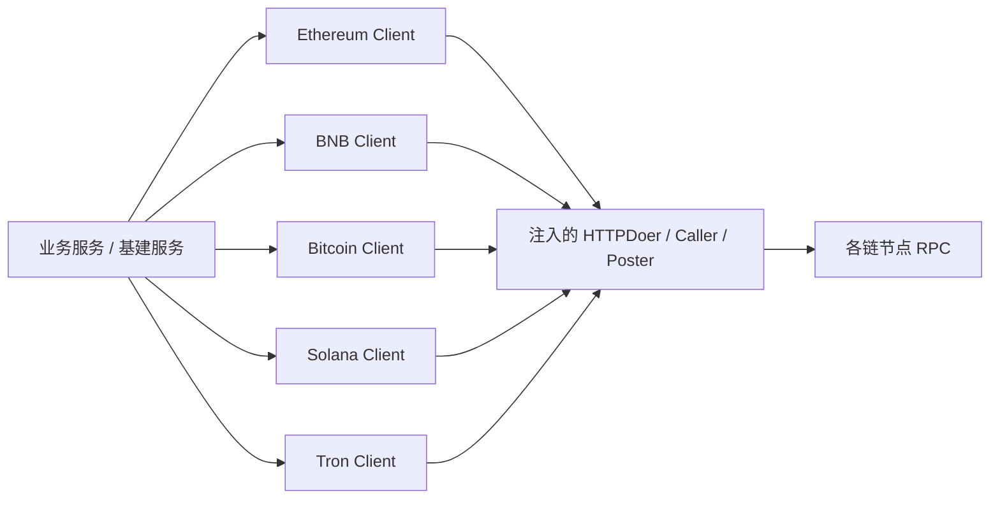
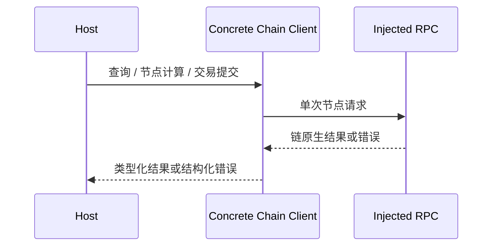

# chain-api-go 技术方案

**规格文档 / Spec**：[spec.md](spec.md)  
**技术方案 / Plan**：[plan.md](plan.md)  
**任务清单 / Tasks**：[tasks.md](tasks.md)  
**基线版本 / Baseline Version**：PLAN-v6+CONTEXT-CAUSE-v1+HARNESS-CONTRACT-v1  
**日期 / Date**：2026-11-16  
**状态 / Status**：已批准（Approved）

## 0. 变更记录 / Change Log

| 版本 / Version | 日期 / Date | 变更 / Change |
|---|---|---|
| HARNESS-CONTRACT-v1 | 2026-11-16 | Human 已批准：冻结 test-only live harness 的显式配置、raw-byte SHA-256、可取消并发等待、总 deadline context、结果优先级与离线并发验证；只重开 T023/T024，保持 5 Plan / 20 Task、任务 ID 与依赖不变。T017–T022 的未受影响证据保持有效。 |
| CONTEXT-CAUSE-v1 | 2026-11-16 | Human 批准安全的跨包 context cause 值方法；重新执行 T017 RED、T018 GREEN 及固定 Auditor 门禁，不增加 Task。 |
| PLAN-v6 | 2026-11-16 | 将 v5 的混合 Task 改为独立测试/实现依赖，活动任务为 T017–T036；补充默认拒绝路径、预算、证据门禁和 constitution 8.6 冲突裁决。功能范围不变；Human 已明确批准本修订。 |

## 1. 设计结论

采用“共享协议层 + 五链原生客户端 + 测试专用 live harness”的结构。共享只发生在传输、错误和 EVM 原生能力层，不引入链适配器、统一访问入口或业务流程。



## 2. 包结构

```text
transport/                 # HTTPDoer 接口
apierror/                  # 安全结构化错误
jsonrpc/                   # JSON-RPC 2.0 / Bitcoin 方言
httpjson/                  # Tron 同 endpoint HTTP JSON
evm/                       # Ethereum/BNB 共用原生类型与方法
ethereum/                  # Ethereum 具体客户端
bnb/                       # BNB 具体客户端
bitcoin/                   # Bitcoin Core 客户端
solana/                    # Solana 客户端
tron/                      # Tron 客户端
internal/test/live/        # 测试专用真实数据装配与证据
```

依赖方向固定为：具体链包 → 协议包 → `transport`；`ethereum`/`bnb` → `evm` → `jsonrpc`；`tron` → `httpjson`。核心包不得反向依赖 live 测试。

## 3. 公共代码契约

```go
type HTTPDoer interface {
    Do(*http.Request) (*http.Response, error)
}

type Caller interface {
    Call(context.Context, string, any, any) error
}

type Poster interface {
    Post(context.Context, string, any, any) error
}

jsonrpc.New(jsonrpc.Config, transport.HTTPDoer) (*jsonrpc.Client, error)
httpjson.New(httpjson.Config, transport.HTTPDoer) (*httpjson.Client, error)

ethereum.New(ethereum.Config, jsonrpc.Caller) (*ethereum.Client, error)
bnb.New(bnb.Config, jsonrpc.Caller) (*bnb.Client, error)
bitcoin.New(bitcoin.Config, jsonrpc.Caller) (*bitcoin.Client, error)
solana.New(solana.Config, jsonrpc.Caller) (*solana.Client, error)
tron.New(tron.Config, httpjson.Poster) (*tron.Client, error)
```

规则：

- 构造函数复制可变配置并拒绝 nil/typed-nil；只做本地校验。
- `context.Context` 是每个 I/O 方法首参；nil context 直接拒绝。
- 金额使用整数、`big.Int` 或精确十进制类型，禁止 `float64` 承载金额。
- nullable 字段必须保留协议语义，不得把缺失解释为零。
- RawCall/RawPost 复用同一安全、限长、context 和错误规则。
- 命名常量类型按底层类型提供 `ToString()`、`ToInt()`、`ToInt32()`、`ToInt64()` 等明确转换方法，不提供含糊的通用 `Value()`。
- 小字段、小结构体及其参数、返回值、构造器传参默认使用值语义。仅 `Client` 等包含大量方法或持有大量依赖并负责复杂生命周期的实现对象允许使用指针。
- 指针规则不授权批量重写既有指针。数据库 `NULL` 或第三方 API 契约需要指针时，记录准确冲突并等待用户决定。
- 核心 SDK 不接收私钥，不提供交易构造、编码、签名或节点解锁能力。说明性 `go-wallet-sdk` 示例若未来获批，只能位于独立 module，并保持默认离线、无默认广播和无真实凭据；本期不要求交付该示例。

### 3.1 值语义接口裁决 / Value-Semantics API Decisions

```go
type CallRequest struct {
    From                       Address
    HasFrom                    bool
    To                         Address
    HasTo                      bool
    Gas                        uint64
    HasGas                     bool
    Value                      big.Int
    HasValue                   bool
    GasPrice                   big.Int
    HasGasPrice                bool
    MaxFeePerGas               big.Int
    HasMaxFeePerGas            bool
    MaxPriorityFeePerGas       big.Int
    HasMaxPriorityFeePerGas    bool
    Data                       Data
}

// evm
func (c *Client) ChainID(ctx context.Context) (big.Int, error)
func (c *Client) GetBalance(ctx context.Context, address Address, at BlockRef) (big.Int, error)
func (c *Client) GetTransactionReceipt(ctx context.Context, hash Hash) (Receipt, bool, error)

// bitcoin
func (c *Client) GetTxOut(ctx context.Context, req GetTxOutRequest) (TxOut, bool, error)
func (c *Client) EstimateSmartFee(ctx context.Context, req EstimateSmartFeeRequest) (FeeEstimate, bool, error)

// solana
func (c *Client) GetLatestBlockhash(ctx context.Context, opts BlockhashOptions) (BlockhashResult, bool, error)
func (c *Client) SimulateTransaction(ctx context.Context, tx EncodedTransaction, opts SimulateOptions) (SimulationResult, bool, error)

// tron
func (c *Client) GetAccount(ctx context.Context, req GetAccountRequest) (Account, bool, error)
func (c *Client) BroadcastTransaction(ctx context.Context, payload TransactionPayload) (BroadcastResult, bool, error)
func (c *Client) GetTransactionInfoByID(ctx context.Context, id TxID) (TransactionInfo, bool, error)
```

可选请求字段按 Has 标记决定是否编码；非负性、费用互斥等校验仅在对应字段提供时执行。SDK 不修改调用方的 `big.Int`。需要保存或复制包含 `big.Int` 的请求/配置时逐字段深拷贝数值；返回的大整数不得与 SDK 内部可变状态共享存储。本设计不引入统一 Optional 抽象。

上述 nullable 签名的第二个返回值统一表示 `present`。合法空结果为 `(零值,false,nil)`，有效结果为 `(值,true,nil)`，错误为 `(零值,false,error)`。成功时协议要求必有结果的方法必须返回 true，不能因增加 bool 而放宽必需字段或响应合法性。

具体链与协议 `*Client` 保持指针构造器和方法接收者，因为这些对象包含大量方法并持有通信依赖。`HTTPDoer.Do(*http.Request) (*http.Response,error)` 仅因兼容标准库 `http.Client.Do` 契约而保留，是本次要求 Human 明确批准的唯一标准库指针签名；不授权其他 SDK DTO 使用指针。

## 4. 错误与提交语义

```go
type Kind string

const (
    Configuration Kind = "configuration"
    InvalidArgument Kind = "invalid_argument"
    Transport       Kind = "transport"
    HTTP            Kind = "http"
    Protocol        Kind = "protocol"
    RPC             Kind = "rpc"
    Unsupported     Kind = "unsupported"
    NetworkMismatch Kind = "network_mismatch"
)

type Error struct {
    Kind              Kind
    Method            string
    HTTPStatus        int
    RPCCode           int
    HasRPCCode        bool
    NodeCode          string
    SubmissionUnknown bool
    cause             error
}

func (e Error) Error() string
func (e Error) Unwrap() error
func (e Error) WithContextCause(err error) Error
```

`HasRPCCode=false` 表示没有节点数字码；为 true 时保留 `RPCCode` 原值，包括零。`cause` 只能为 nil、`context.Canceled` 或 `context.DeadlineExceeded`；底层包装错误只判断是否属于这两个哨兵并保存哨兵本身，同时匹配时优先 `context.Canceled`。`Error()` 不得包含原始 Cause、Message、Data、endpoint、Header 或完整载荷，`Unwrap()` 只返回 cause。

`WithContextCause` 是跨包设置 cause 的唯一批准入口，并使用值接收者和值返回。它不得保存传入 error：先用 `errors.Is` 判断 `context.Canceled`，再判断 `context.DeadlineExceeded`，分别只保存对应标准库哨兵；nil 或其他错误将 cause 清空。原 `Error` 值不得被修改。此方法不授权通用 Cause 字段、任意 error 包装或新的错误构造抽象。

`Kind` 的底层类型为 string，必须提供 `func (k Kind) ToString() string`。SDK 产生的错误以 `Error` 值装入 error 接口；调用方使用 `var e apierror.Error; errors.As(err, &e)` 提取值，不公开 `*Error` 返回契约。

错误对象不得保存 URL、Header、请求/响应正文、原始底层错误字符串或完整交易载荷。只有 `context.Canceled` 与 `context.DeadlineExceeded` 可以安全参与 `errors.Is`。

提交调用进入注入依赖后，如果发生传输、HTTP、协议或取消错误，`SubmissionUnknown=true`；本地校验失败或可信节点明确拒绝则为 false。SDK 不根据错误文本猜测请求是否到达节点。

## 5. 五个功能 Plan

| Plan | 功能边界 | Tasks | 独立验收 |
|---|---|---|---|
| PLAN-001 公共基础 | module、DI、错误、JSON-RPC、HTTP JSON、live harness 基础 | T017–T024 | AC-01–04、09、12、13 |
| PLAN-002 EVM | EVM 原生类型与方法、Ethereum/BNB 具体客户端 | T025–T026 | AC-02、05、12、13；T036 最终验收 |
| PLAN-003 Bitcoin | Bitcoin 查询、预检与提交 | T027–T028 | AC-02、06、12、13；T036 最终验收 |
| PLAN-004 Solana | Solana 查询、模拟与提交 | T029–T030 | AC-02、07、12、13；T036 最终验收 |
| PLAN-005 Tron 与最终集成 | Tron、五链 runner、文档与最终验收 | T031–T036 | AC-01–13 |

每个行为实现 Task 必须依赖更早的失败测试 Task；RED 由测试 Task 留证，GREEN/Refactor 由对应实现 Task 完成。不得把两者写成同一 Task 的内部步骤来替代依赖门禁。各链方法范围仍以 spec §3 和本方案既有契约为准，不按单个 RPC 方法继续拆分。

默认依序处理 PLAN-001→002→003→004→005。依赖满足并不自动授权并行 Agent。测试/实现 Task 之间不设置要求全部测试为绿的独立交付门禁；子 Plan 交付时必须全部转绿并完成规定审核。

## 6. 请求流程



## 7. 测试与真实验收设计

### 7.1 本地测试

- fake Caller/Poster 验证方法、参数、交易载荷字节、调用次数和错误分类。
- `httptest` 验证 HTTP 状态、超限响应、body 关闭、取消与路径边界。
- 表格驱动 fixture 验证金额精度、编码、null、pending、commitment、solidified 等链原生语义。
- 提交测试断言载荷不变且 SDK 只发起一次调用。
- API 审核逐项检查命名常量转换方法和小结构体值语义；指针冲突必须区分 SDK 自有设计、数据库 `NULL` 与第三方 API 契约。
- 依赖与公开 API 审核确认核心不存在私钥、构造、编码、签名或节点解锁能力；可选说明性示例不得进入核心依赖图。

### 7.2 live harness：HARNESS-CONTRACT-v1（已批准）

以下 HC-01–HC-08 是 AC-09 的已批准精确契约；条款 ID 不属于活动 Task。它们仅作用于 `internal/test/live`，不能扩展核心 SDK 的配置读取、调度或链访问职责。

#### HC-01：边界与开关

- `internal/test/live` 是测试装配；核心 SDK 仍不读 env/file。
- `runHarness(..., enabled=false, ...)` 立即返回 `NOT_RUN`，不调用配置 loader、manifest loader、clock、waiter 或 case；请求数为零。
- 实际入口只能读取 live 开关以决定是否启用；关闭后不得读取配置路径变量、Header 引用变量、配置文件、manifest 或交易材料。
- 无默认 endpoint、HTTP client、配置路径、凭据、重试、轮询、后台 worker、文件 watcher 或网络 fallback。
- 本次仅批准离线基础；T033/T034 负责五链装配，T036 才可能在独立授权后执行真实验收。

#### HC-02：内部测试边界

```go
type harnessConfig struct {
    Alias, Endpoint, Network string
    Headers map[string]string
    MaxRequests, MaxConcurrent int
    MinInterval, TotalTimeout time.Duration
    DynamicInputsPath, SubmissionMaterialPath string
}

type harnessDeps struct {
    Load func() (harnessConfig, error)
    LoadManifest func() ([]byte, string, error)
    Now func() time.Time
    Wait func(context.Context, time.Duration) error
}

type harnessRequest func(func(context.Context) error) error

type harnessCase struct {
    ID string
    Run func(context.Context, harnessRequest) (string, error)
}

type harnessReport struct {
    Status, Category, Digest string
    Requests int
    Cases map[string]string
}

func runHarness(context.Context, bool, harnessDeps, []string, []harnessCase) harnessReport
func loadHarnessConfig(path, alias string, readFile func(string) ([]byte, error), lookupEnv func(string) (string, bool)) (harnessConfig, error)
func verifyManifest(raw []byte, expectedDigest string) (string, error)
```

- `LoadManifest` 避免 live 开关判断前读取材料；request closure 不再接收调用方 context，所有请求使用 harness 派生 context。
- 小结构体为值语义，配置 map 必须复制；`harnessRequest` 是函数类型，不是命名常量类型。
- `Now` 与 `Wait` 不允许 nil fallback；真实装配显式注入同一时钟域的 `time.Now` 和 context-aware timer wait。
- deadline 使用标准库 `context.WithDeadline`，不新增 clock framework、第三方依赖或 deadline factory。
- callback 必须同步结束自身启动的 goroutine，不得保存 request closure。harness 自身不启动 worker goroutine，不支持 operation 递归调用同一 limiter。
- 非 nil context、loader、clock、waiter、case callback 的校验失败均在请求前 BLOCKED。

#### HC-03：外部配置

配置格式冻结为 JSON：

```json
{
  "targets": {
    "example": {
      "endpoint_env": "CHAIN_API_GO_EXAMPLE_ENDPOINT",
      "header_env": {"Authorization": "CHAIN_API_GO_EXAMPLE_AUTHORIZATION"},
      "network": "example-network",
      "max_requests": 10,
      "max_concurrent": 1,
      "min_interval": "1s",
      "total_timeout": "30s",
      "dynamic_inputs_path": "",
      "submission_material_path": ""
    }
  }
}
```

- `path` 和 `alias` 必须显式非空；只读取指定路径一次，不搜索 CWD、home、参考仓库或公共节点。
- 具体链 runner 显式选择 alias 并创建具体客户端；`targets` 不建立 SDK dispatcher。
- endpoint 仅通过 `endpoint_env` 获取；Header 值仅通过 `header_env` 获取。环境值按原样使用，不支持插值、递归展开、默认值、shell 或命令替换。
- env 引用名匹配 `[A-Za-z_][A-Za-z0-9_]*`；缺失或空值 BLOCKED，错误不得回显变量值、endpoint、Header 或路径。
- endpoint 必须是有 host 的 `http`/`https` URL 且无 fragment；不改写、不拼接、不猜测其他链 URL。
- Header 名必须为合法 HTTP token，大小写归一后不能重复；值不得含 CR/LF。
- 必须恰有一份 JSON object；拒绝 unknown fields、重复键（包括解码后相同的转义键）、尾随文档和类型错误。
- 四个限额均严格大于零；duration 使用 `time.ParseDuration`，不接受隐含单位、缺省值或溢出。
- 两个 material path 是可选字符串，仅保存、不展开、不打开；对应材料必需性仍由 T033/T034 验证。
- loader 不返回部分可用配置；错误只保留安全类别，不保留原始 `PathError`、URL 或 JSON 错误文本。
- `config.example.json` 只含上述占位引用，不含实际 URL、Header 值、Token 或交易载荷；普通测试只可读取仓库模板。

#### HC-04：Manifest 身份

- `verifyManifest` 对传入 raw bytes 计算 SHA-256，返回 64 位小写十六进制；预期摘要必须独立冻结，不能由同一输入运行时生成。
- 哈希覆盖全部字节，包括空白、换行、键顺序、数组顺序和时间元数据；不删除字段、不 canonicalize。
- 输入还须为一份合法非 null JSON object，拒绝重复键和尾随文档；语义内容与五链覆盖仍由后续 runner 负责。
- 缺失、格式错误或摘要不匹配在 case/网络调用前 BLOCKED；成功报告绑定实际摘要，失败不输出原始 manifest。
- 本条取代 architecture §12.5 的规范化摘要草案；本修订不编辑 architecture，也不形成 constitution 例外。

#### HC-05：请求与资源

- 一个请求单位是一次被 limiter 接纳并进入 operation callback 的调用，包括失败调用；不宣称等于实际网络报文数或供应商 credit。
- 每个 operation 最多调用一次注入的实际请求依赖；不得隐藏多次 RPC、重试或广播。
- 达到 `MaxRequests` 后下一次请求立即拒绝并 BLOCKED；拒绝不增加计数。
- 容量满时等待且响应 suite context 取消；容量本身不产生 FAIL/BLOCKED。
- 活跃 operation 不超过 `MaxConcurrent`；请求计数、槽位、开始时刻和错误账本必须并发安全。
- 相邻被接纳 operation 的实际开始时刻至少间隔 `MinInterval`；第一项无需等待。等待后重新检查 deadline 和预算。
- operation 返回后释放槽位；取消、等待失败和预算拒绝不得泄露槽位或消耗请求数。
- 不承诺 FIFO、公平性、优先级或后台调度。

#### HC-06：总 timeout

- 总执行预算从本地配置、manifest、catalog 校验完成并准备执行首个 case 时开始。
- `deadline = min(parent deadline, start + TotalTimeout)`；所有 case、排队、速率等待和 operation 共用派生 context。
- 总时限覆盖整个 case 执行阶段和在途 I/O；同步本地文件读取不承诺被该 deadline 强行中断。
- admission 前、等待后、operation 返回后检查 context 和时间；`now >= deadline` 不接纳新 operation。
- deadline 到达时 `Done()` 关闭，operation 可观察 `context.DeadlineExceeded`；父取消传播，不得 detached。
- 返回前取消派生 context 并释放 timer；不关闭调用方 HTTP transport。
- 依赖须尊重 context；harness 不以泄漏 goroutine 的方式强杀不合作 callback。

#### HC-07：账本、错误与优先级

- required IDs 独立、非空、无空 ID/重复 ID。cases 可缺项以保留事实；重复/未知/child-only/nil Run 属于 catalog invalid，在请求前 BLOCKED。
- 每个 required ID 初始 `NOT_RUN`，每个 case 至多执行一次；不能用其他 ID 补足。
- 启用后：存在明确失败则总体 `FAIL`；无失败但有 BLOCKED、NOT_RUN、缺项或资源阻塞则总体 `BLOCKED`；全部 required PASS 且无基础错误才总体 `PASS`。关闭开关总体 `NOT_RUN`。
- 非法 callback status 或未分类非 nil callback/operation error 为 FAIL；明确 context cancel/deadline 为 BLOCKED。
- 包内值错误 `harnessFailure{Status, Category string}` 仅接纳 FAIL/BLOCKED 和类别 assertion/environment；非法值按 `FAIL/invalid_result`，`Error()` 只输出类别。
- 预期节点拒绝由 callback 完成断言后返回 nil；limiter/operation 失败为 sticky，callback PASS 不能覆盖。
- case 与总体均按 `FAIL > BLOCKED > PASS`；未运行项保留 NOT_RUN。相同严重度按固定类别字典序选择摘要，避免并发顺序影响报告。
- 报告仅含状态、固定安全类别、合法 required ID、digest 和请求数；不保存任意错误文本或 config。
- 不做 panic recover/logging；callback panic 由 Go 测试进程失败。

#### HC-08：确定性离线验证

- 使用 Go 1.25 标准库 `testing/synctest` 与 channel/barrier，不新增依赖；真实启动 `limit+1` 个 goroutine，证明额外请求等待、释放后继续，并覆盖 limit 1/2。
- 使用原子或 mutex 验证 peak、callback 次数、请求账本及全部 goroutine 退出；race 检查是强制门禁。
- synctest 内使用 `time.Now` 和 context-aware timer waiter，统一 fake time 与 context timer；不再只修改局部 fake clock。
- 检查 operation 的 Deadline、更早父 deadline、预取消、排队/速率等待取消、在途 Done、截止边界与 timer 清理。
- raw digest 使用独立 literal；空白/键序变化必须在旧摘要下失败。malformed/duplicate/trailing 使用各自匹配 raw digest，避免只因 hash 不同造成假覆盖。
- config 测试注入 reader/env map，断言精确路径/读取次数；仅使用临时合成文件组合正例，不读取用户实际 env/config。
- 脱敏覆盖 loader、parser、manifest、waiter、operation、case；检查 error、JSON 与 `%v/%+v/%#v` 无合成秘密。
- 覆盖混合 FAIL+BLOCKED、预算错误被忽略、request error 被 PASS 覆盖、缺项和 child-only 冒充。

### 7.3 开关

- `CHAIN_API_GO_LIVE_TEST=1`：允许真实只读验收。
- `CHAIN_API_GO_LIVE_BROADCAST=1`：在 live 开关之外单独允许受控提交。
- `CHAIN_API_GO_LIVE_CONFIG`：由用户设置的外部配置路径；不得提交配置内容。

### 7.4 Task Contract / Task Contract

```yaml
planning_baseline:
  version: PLAN-v6+CONTEXT-CAUSE-v1+HARNESS-CONTRACT-v1
  approval_status: approved
  approved_file_set:
    - docs/superpowers/001-chain-api-go/spec.md
    - docs/superpowers/001-chain-api-go/plan.md
    - docs/superpowers/001-chain-api-go/tasks.md
  constitution_version: "1.1"
  manifest: not_applicable_single_requirement

workflow_state:
  current: READY_FOR_T025_RED
  blocked_tasks: []
  preserved_completed_tasks: [T017, T018, T019, T020, T021, T022]
  execution_sequence: [T023_RED, T023_READ_ONLY_AUDIT, T024_GREEN_REFACTOR, T024_READ_ONLY_AUDIT]
  coder_may_report: [IMPLEMENTED]
  transitions: [IMPLEMENTED, LOCALLY_VERIFIED, READY_FOR_AUDIT, AUDIT_PASSED, DONE]
  done_requires: [valid_snapshot_bound_evidence, auditor_pass_recommendation, human_final_approval]

scope:
  allowed_paths: "每个 Task 中展开列出的路径，仅对该 Task 有效"
  allowed_behavior_changes: "spec §3、AC-01–13 与本方案既有接口"
  invariants: "spec C-01–10；constitution 1.1 全文"
  non_goals: "spec §6；无服务、索引、后台机制、新依赖或本期钱包示例"
  protected_evidence: "先行测试断言、批准验收标准、冻结样本及摘要"
  requires_approval:
    - "扩大路径、行为、公开 API、依赖或配置范围"
    - "改变受保护测试、样本或验收标准"
    - "新增后台行为、抽象层或并发机制"
    - "constitution、数据库 NULL 或第三方契约冲突"

audit_test_scope:
  allowed_paths: []
  access: read_only
  supplemental_test_writes_require_separate_approval: true

verification_layers:
  L1: "必需：需求、不变量与双向追踪"
  L2: "必需：聚焦编译、vet、依赖和公开 API"
  L3: "必需：表格驱动单元、边界和异常测试"
  L4: "子 Plan 仅 fake/httptest 契约；真实集成延后 T036"
  L5: "仅批准风险：错误脱敏、资源关闭、请求预算、JSON-RPC ID race、live limiter/账本 race 与 context deadline 生命周期"
  L6: "不适用：无部署交付；真实链验收属于 T036"

harness_contract_delta:
  affected_tasks: [T023, T024]
  authority: "spec AC-09/§5.1；plan §7.2 HC-01–HC-08"
  protected_test_revision:
    permitted_only_in: T023
    reason: "旧断言包含未经批准的 digest/admission/status 选择，且缺 config/deadline/race 边界"
    becomes_protected_after: "新 T023 RED 与固定 Auditor 审核通过"
  production_concurrency:
    permitted: "请求 closure 的可取消等待、同步槽位/计数/速率控制"
    prohibited: "后台 worker、自动重试、轮询、FIFO/优先级框架"
  external_read:
    permitted: "仅 test-only 显式路径与注入 env lookup"
    prohibited: "核心 SDK 读取、默认路径、公共 RPC fallback、关闭开关后读取"
  historical_evidence: "旧 T023 保留为历史，不作为本版本门禁凭据"

evidence_provenance:
  bind_to: [task_id, acceptance_ids, command, exit_code_and_result, code_snapshot, test_snapshot, dependency_state, redacted_configuration_identity, environment]
  invalidate_when: "相关输入变化时只使受影响证据失效"
  rerun_policy: "复用有效证据；失败修复或输入变化后只重跑受影响检查"

failure_routing:
  F1_F4: "同一 Coder 闭环；权限扩大交 Human"
  F5_F6: "有证据才返回 Planner；需求裁决由 Human 作出"
  max_same_signature_diagnostic_cycles: 3
  on_exhaustion: "停止循环，报告日志、已尝试方案与所需输入"

integration_stage:
  test_commands_allowed: false
  permitted_checks: "Git/worktree/diff/身份/冲突结构检查"
  commit_push_pr_merge: "无授权；当前用户未要求"
  on_content_change: "退出集成，返回受影响实现、验证、审核和 Human 门禁"

rollback:
  method: "依据 pre-task snapshot 撤回该 Task 自有增量；不得 reset 全仓或覆盖用户改动"
  trigger: "越界、无法复现、违反不变量或审批撤回"

stop_conditions:
  - "三件套未落盘、元数据不一致、缺字段，或当前待执行 Task 对应基线未获 Human 明确批准"
  - "角色固定模型不可用且没有明确降级授权"
  - "需要扩大范围或出现规范/协议冲突"
  - "无法取得可信 RED/GREEN 或最终真实材料"
```

### 7.5 两级验证与双向追踪 / Two-Level Verification and Traceability

| Plan | per_plan_checks | final_acceptance_contribution |
|---|---|---|
| PLAN-001 | T017–T024 对应命令；协议 fake/httptest、race、安全与 harness 契约 | T036 的开关、预算、摘要、账本与脱敏 |
| PLAN-002 | `go test ./evm ./ethereum ./bnb`；两具体客户端分别覆盖 | T036 Ethereum 与 BNB 各至少 3 样本及分别授权提交 |
| PLAN-003 | `go test ./bitcoin` | T036 Bitcoin 样本、历史能力、精确金额、授权提交 |
| PLAN-004 | `go test ./solana` | T036 Solana 样本、meta/版本/动态输入、授权提交 |
| PLAN-005 | `go test ./tron`；runner 离线契约；`go vet ./...` | T036 Tron 样本及五链最终去重验收 |

| 计划变化 / Planned Change | 批准依据 / Authority |
|---|---|
| transport、apierror、jsonrpc、httpjson | spec §3.1，C-02/05/06，AC-02–04 |
| evm、ethereum、bnb | spec §3.2，AC-05 |
| bitcoin | spec §3.2，AC-06 |
| solana | spec §3.2，AC-07 |
| tron 与五个 solidified 查询 | spec §3.2，AC-08 |
| live 配置、开关、账本、runner、样本、证据 | spec §5，AC-09–11 |
| HARNESS-CONTRACT-v1 HC-01–HC-08 | spec AC-09、AC-04、C-02/05/06/08/09；T023 RED → T024 GREEN；不改变 T033–T036 依赖与真实验收职责 |
| 常量转换、值语义和核心依赖/API 审查 | constitution 5.1–5.3、8.5/8.6，AC-12/13 |
| README/GoDoc/AGENTS 基线同步 | AC-01、12、13；不授权改变 constitution |

`final_acceptance_checks` 只有 T036：依赖全部五个 Plan 的本地交付；缺少真实调用、提交授权或材料时状态为 BLOCKED，不能 PASS。

### 7.6 资源预算与冲突门禁 / Budget and Conflict Gate

HARNESS-CONTRACT-v1 的 T023、T024 各自最多 70 分钟：规划 20 分钟、编码 20 分钟、验证最多 30 分钟。该时间是实际执行上限，不再套用 40%/5%/55% 的机械小时换算。任务总数仍为 20；生产行、测试行和文件数只作为范围漂移预警，不是目标额度，也不得成为延长工期、增加抽象或重复验证的理由。

`docs/architecture.md` 中仍存在与 constitution 8.6 不一致的小 DTO 指针、`(nil,nil)` 与原始错误示意。`PLAN-v6` 只批准在三件套明确冻结的值字段和存在性状态方向；其他冲突在对应 Task 开始前必须逐项说明并由 Human 决定，不能由 Coder 自行扩大例外。

本方案 §3.1 与 §4 是 `PLAN-v6` 对 `docs/architecture.md` §7.2–7.4、§10.1 中相应签名和错误字段的替代设计。旧文档的指针示例、nullable `(nil,nil)` 示例及原始错误字段不得作为实施授权。Human 对 `PLAN-v6` 的明确批准同时裁决上述已列冲突；除这些替换外，不扩大、弱化或推定任何 constitution 例外。架构文档的文字同步须另取得路径授权。

## 8. 验证命令

以下命令在对应 Task 实现后建立：

```sh
go test ./apierror ./jsonrpc ./httpjson
go test -race ./jsonrpc
go test ./evm ./ethereum ./bnb
go test ./bitcoin ./solana ./tron
go test ./internal/test/live -run '^TestHarness' -count=1
go test -race ./internal/test/live -run '^TestHarness' -count=1
go test ./internal/test/live -run '^TestHarness|TestReadContract|TestSubmissionContract'
go vet ./...
```

真实只读和提交只在审批后的最终窗口运行：

```sh
CHAIN_API_GO_LIVE_TEST=1 go test ./internal/test/live -run '^TestLiveRead$' -count=1
CHAIN_API_GO_LIVE_TEST=1 CHAIN_API_GO_LIVE_BROADCAST=1 go test ./internal/test/live -run '^TestLiveBroadcast$' -count=1
```

## 9. 角色与门禁

- 所有角色开始工作前读取根目录 `AGENTS.md` 与 `constitution.md`；违反 constitution 的设计或实现不得进入审核。
- Planner：`gpt-6-astra / high`，只读规划。
- Coder：`gpt-6-astra / low`，只能修改获批 Task 的路径。
- Auditor：固定 `gpt-5.6-sol / medium`，必须是全新只读上下文；当前运行时未提供该模型时不得静默替换。
- Human：已批准 PLAN-v6、CONTEXT-CAUSE-v1 与 HARNESS-CONTRACT-v1，并已批准审计通过的 T023/T024。当前按 T025 RED → 固定 Auditor → T026 GREEN/Refactor → 固定 Auditor 推进 EVM 子 Plan；既有角色和最终 Human 门禁保持不变。

T017–T024 已有效通过。旧 T023 证据仅保留为历史；新版 T023/T024 已通过固定审计与 Human 门禁，T025 可启动。当前没有真实 RPC 或交易提交授权。
